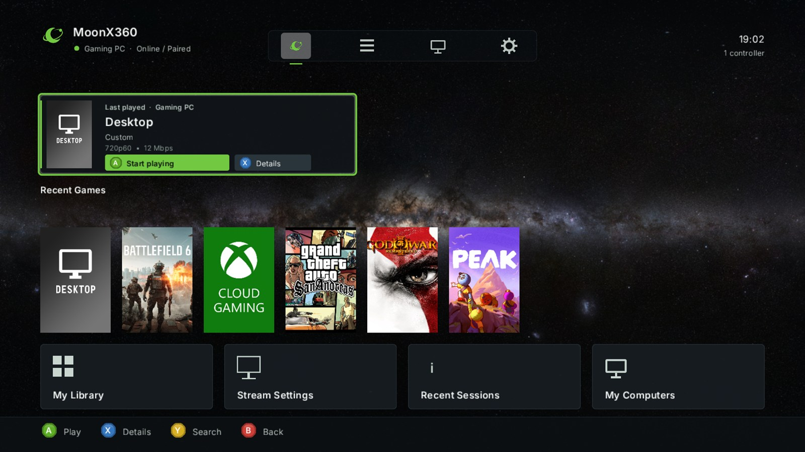
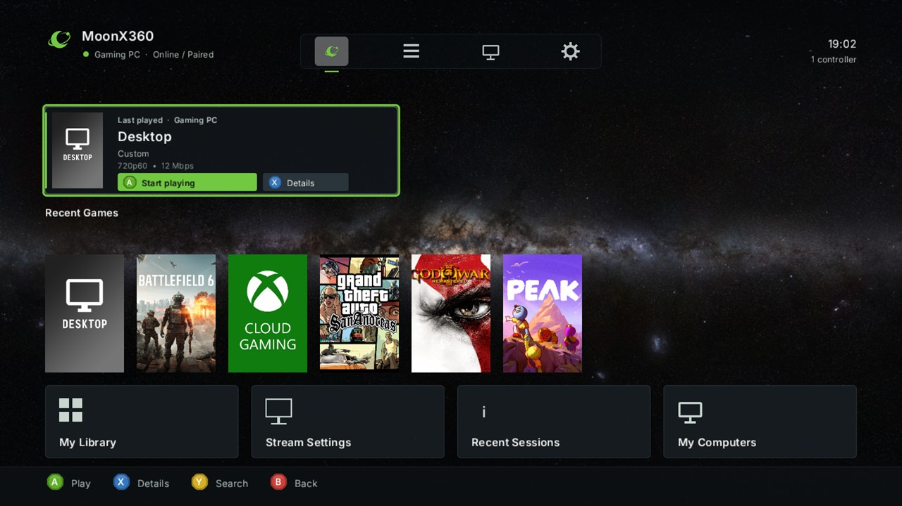
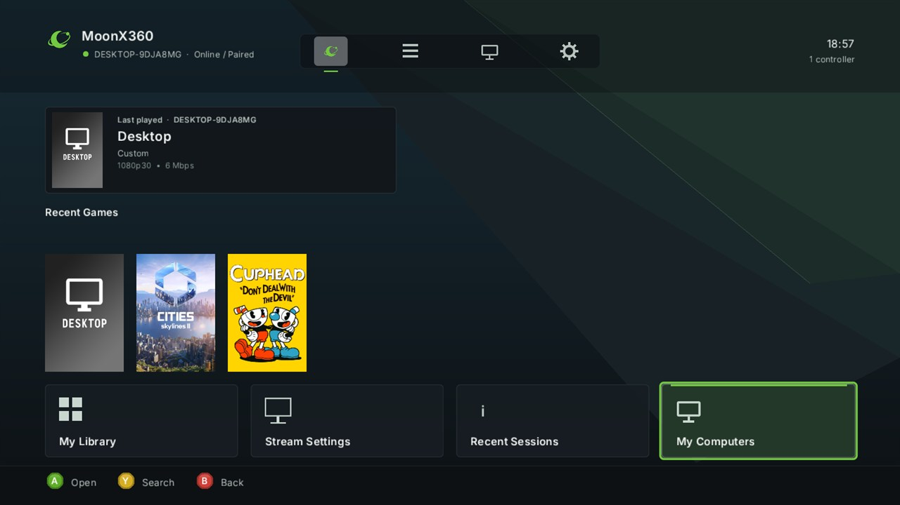
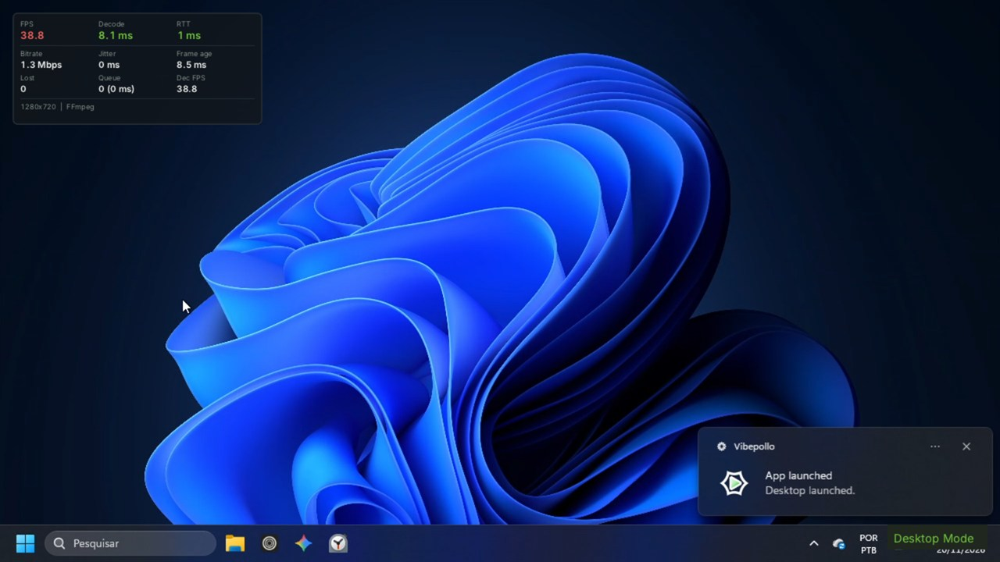
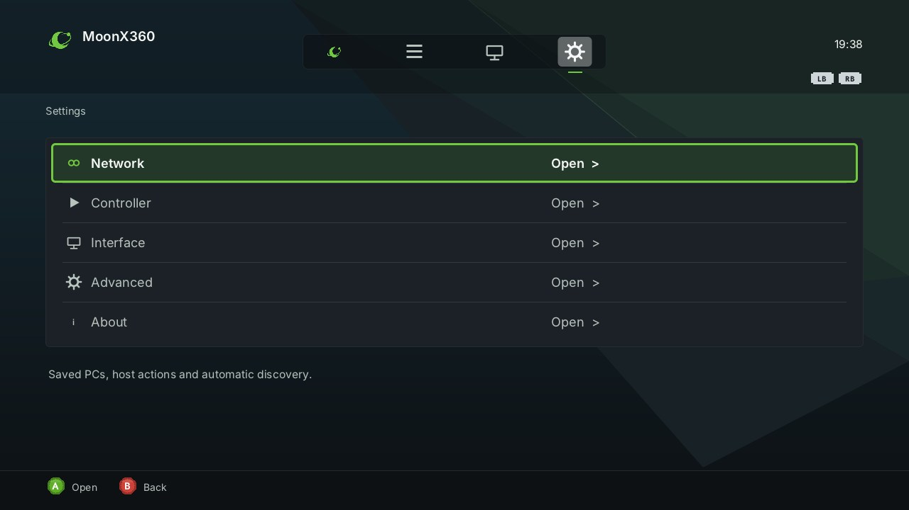
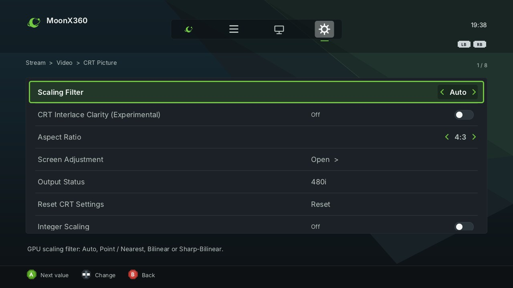
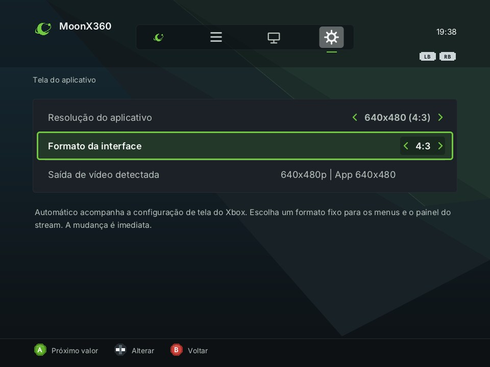
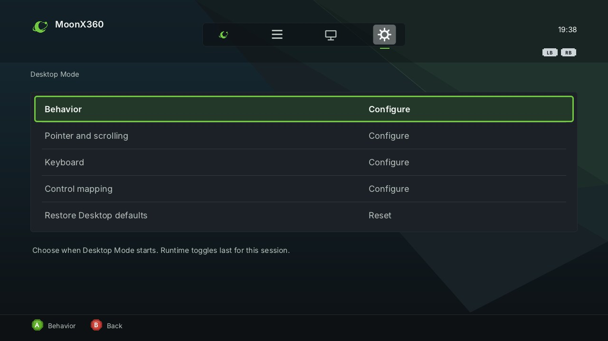
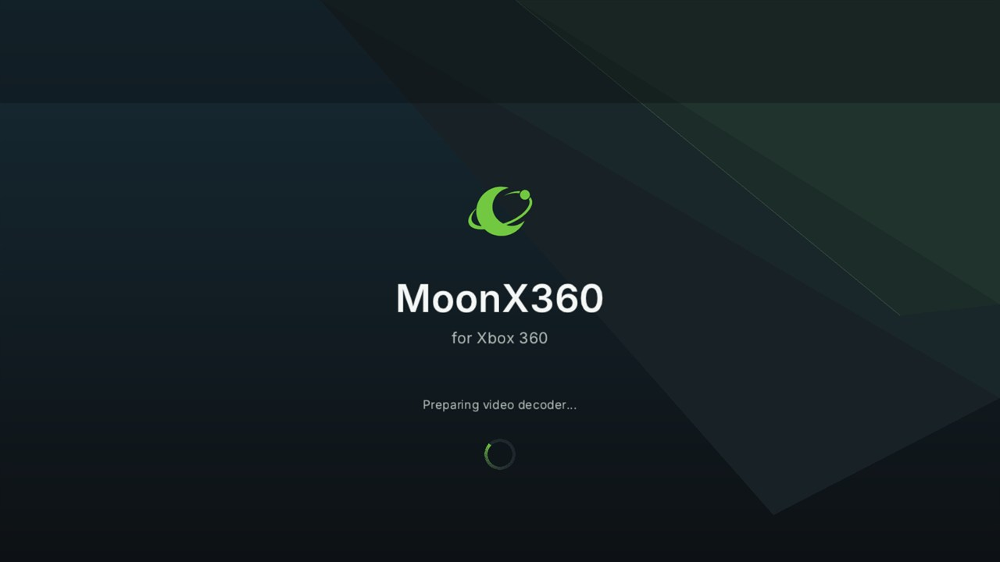
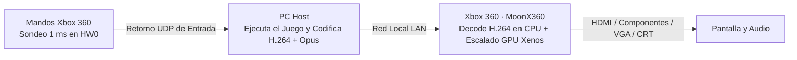

  

<h1 align="center">Tus juegos de PC. Tu Xbox 360.</h1>

  

  
  
  
  
  
  

  <a href="README.md">English</a> · <a href="README.pt-BR.md">Português (Brasil)</a> · <b>Español</b>

  <a href="https://github.com/fransley2/MoonX360/releases"><b>Descargar</b></a> ·
  <a href="#instalación-en-3-pasos">Instalación</a> ·
  <a href="#resultados-de-rendimiento">Rendimiento</a> ·
  <a href="#controles">Controles</a> ·
  <a href="#preguntas-frecuentes-y-solución-de-problemas">FAQ</a> ·
  <a href="https://github.com/fransley2/MoonX360/issues">Soporte e Issues</a>

**MoonX360** es un cliente nativo de **streaming Moonlight para Xbox 360**. Tus juegos y aplicaciones se ejecutan en un PC compatible (con **Apollo**, **Sunshine** u otro servidor compatible con GameStream), mientras la Xbox 360 recibe video H.264 y audio por la red local y envía las entradas del mando de vuelta al PC. MoonX360 **no** ejecuta juegos modernos de PC de forma nativa en el hardware de Xbox 360.

---

## Novedades en v0.2.6

- **Mando más reactivo bajo cargas exigentes** — El hilo de lectura XInput (`1 ms`) se fijó en el hilo de hardware `0` de Xenon (`E7`), reduciendo el jitter de programación de entrada P95 en ~80% durante sesiones 720p60 exigentes.
- **Mejor ritmo de fotogramas y menor latencia de presentación** — El modo `Latest Frame Wins` (`E9`) se activa por defecto, reduciendo Admit-to-VBlank P95 en ~13% con cero fotogramas descartados en tres sesiones de validación de 120 segundos.
- **Subida de texturas de video más rápida** — Transferencias contiguas de planos YUV con precarga de caché (`E5b`, `__dcbt` / `__dcbz128`) reducen el tiempo de subida en ~20,5% y recortan picos de decodificación.
- **Manejo más eficiente de paquetes Ethernet por cable** — Usa automáticamente paquetes UDP de `1392 bytes` en enlaces cableados a `>= 4 Mbps` (`E8`), conservando `768 bytes` para Wi-Fi.
- **Mayor consistencia del decodificador H.264** — Incorpora optimizaciones de loop-filter luma/chroma y compensación de movimiento chroma VMX1D (`v026-rc2`) sobre `batch16`, reduciendo el decode P95 en estado estable en ~4%.
- **`default.xex` en archivo único y Actualización Automática firmada** — Distribución simplificada en un único `default.xex` permanente (**Configuración → General → Actualizaciones de la app**) con verificación Ed25519 + SHA-256, HTTPS TLS 1.2 validado, canales **Estable** / **Beta**, reversión automática tras fallos, recuperación mediante `LB + RB + Back` y conservación total de `moonlight/`.
- **Mejoras en el cierre de conexiones** — Se corrigió `src/http.c` para enviar `Connection: close` y cerrar el socket TLS de inmediato, evitando sockets inactivos que bloqueaban el puerto `47984` en Apollo / Vibepollo / Sunshine.
- **Dashboard estilo Xbox Series, Modo Escritorio suave y Smart Keyboard** — Pantallas Inicio, Biblioteca, Equipos y Configuración rediseñadas con carátulas `2:3`, indicadores giratorios, ratón analógico con zona muerta radial a `125 Hz`, teclado virtual PC de 5 filas, emulación de **PC Guide** (`Start + LB`), **Explorador de Archivos 2.0** y **CRT Retro 2.0**.

Consulta el historial completo en [CHANGELOG.md](CHANGELOG.md).

---

## Resultados de Rendimiento

Medido en **Xbox 360 física** (`1280×720 @ 60 FPS`, **Apollo**, H.264, `CAVLC`, `8` slices, `10 Mbps`, deblocking completo de fotogramas de referencia, `VSync` activado, tres sesiones intercaladas de **120 segundos** por configuración):

- **~80% menor** jitter de programación de entrada P95 (`11,55 ms → 2,30 ms`)
- **~20% más rápida** la subida de texturas YUV (`1,14 ms → 0,91 ms` promedio)
- **~13% menor** latencia de presentación (`32,03 ms → 27,89 ms` Admit-to-VBlank P95)
- **~4% menor** decode H.264 P95 en estado estable (`14,95 ms → 14,37 ms`)
- **~59,5 FPS presentados** a `720p60` nativo (`59,51` promedio incl. inicio)
- **0 fotogramas descartados, 0 errores de decodificación y 0 cortes de audio** en las tres sesiones finales de validación (`Final-r1..r3`)

| Métrica | Base | Optimizado (`v0.2.6`) |
|---|---:|---:|
| Promedio de decode *(estado estable 45s)* | `13,22 ms` | **`12,94 ms`** |
| Decode P95 *(estado estable 45s)* | `14,95 ms` | **`14,37 ms`** |
| Decode P99 *(estado estable 45s)* | `15,15 ms` | **`14,67 ms`** |
| Promedio de subida YUV | `1,14 ms` | **`0,91 ms`** |
| Admit-to-VBlank P95 | `32,03 ms` | **`27,89 ms`** |
| Jitter de programación de entrada P95 | `11,55 ms` | **`2,30 ms`** |
| FPS presentados | `59,49` | **`59,51`** |

> [!IMPORTANT]
> - **Jitter de entrada vs. latencia total a pantalla:** `2,30 ms` P95 mide el **jitter de programación de entrada en el cliente** (regularidad del sondeo del mando), no la latencia total de botón a pantalla.
> - **Copia YUV contigua:** La transferencia planar contigua acelera la copia CPU→GPU (`CPU_CACHED_TEXTURE`), **no** es decodificación zero-copy.
> - **Nota aislada de FEC:** La ejecución `Final-r1` registró un déficit aislado de `11` paquetes FEC (`0` en `r2`/`r3`, `0` errores de decodificación). En redes locales con pérdida de paquetes puedes volver a `1024 B` en Configuración.

Metodología detallada, poblaciones de muestreo y experimentos rechazados en [docs/PERFORMANCE.md](docs/PERFORMANCE.md).

---

## Características Destacadas

<table>
  <tr>
    <td width="50%" valign="top">
      <h3>Streaming de Juegos de PC</h3>
      Transmite Steam, Epic Games, Xbox PC Game Pass, GOG, emuladores y tu escritorio de Windows desde un PC compatible.
    </td>
    <td width="50%" valign="top">
      <h3>Streaming de Baja Latencia</h3>
      Decodificación H.264 paralela con deblocking normativo, sondeo en HW0, subida YUV contigua y presentación Latest-Frame-Wins.
    </td>
  </tr>
  <tr>
    <td width="50%" valign="top">
      <h3>Dashboard Nativo de Xbox 360</h3>
      Vistas <b>Inicio</b>, <b>Biblioteca</b>, <b>Equipos</b> y <b>Configuración</b> con carátulas 2:3, favoritos, sesiones recientes y fondos personalizados.
    </td>
    <td width="50%" valign="top">
      <h3>Perfiles de Transmisión</h3>
      Perfiles de fábrica (<b>Smooth</b>, <b>Performance</b>, <b>High Quality</b>, <b>Standard</b>, <b>Wireless Stable</b>, <b>CRT</b>, <b>1080p30</b>) y perfiles por juego.
    </td>
  </tr>
  <tr>
    <td width="50%" valign="top">
      <h3>CRT y Pantallas Retro</h3>
      Interfaz 4:3, perfiles CRT, filtros de escalado (Point, Bilinear, Sharp-Bilinear), posición/overscan y área segura. El modo <b>240p</b> requiere salida <code>480i</code> y plugin externo <code>t240.xex</code>.
    </td>
    <td width="50%" valign="top">
      <h3>Panel de Rendimiento</h3>
      Overlay <b>Básico</b>, <b>Detallado</b> y <b>Desarrollador</b> con FPS en vivo, tiempo de decode, RTT, cola, descartes y contadores RTP/FEC.
    </td>
  </tr>
  <tr>
    <td width="50%" valign="top">
      <h3>Menú Rápido</h3>
      Menú deslizante en partida (<code>Back + L3</code>) para volumen/silencio, refresco de imagen, modo ratón, Smart Keyboard, overlay y desconexión.
    </td>
    <td width="50%" valign="top">
      <h3>Modo Escritorio y Smart Keyboard</h3>
      Control de ratón analógico con zona muerta radial, teclado virtual PC completo de 5 filas con sugerencias offline y soporte para teclado USB de Xbox 360.
    </td>
  </tr>
  <tr>
    <td width="50%" valign="top">
      <h3>Lanzamiento Directo en Aurora</h3>
      Genera accesos directos (<code>MoonX360Shortcut</code>) para lanzar juegos de PC directamente desde la biblioteca de Aurora.
    </td>
    <td width="50%" valign="top">
      <h3>Compatibilidad e Idiomas</h3>
      Compatible con <b>Sunshine</b>, <b>Apollo</b> y forks de GameStream. Interfaz en <b>Inglés</b>, <b>Español</b> y <b>Portugués (Brasil)</b>.
    </td>
  </tr>
</table>

---

## Galería de Capturas

<table>
  <tr>
    <td width="50%" align="center" valign="top">
      
       <b>Pantalla de Inicio (Home)</b> (Captura real en hardware Xbox 360)
    </td>
    <td width="50%" align="center" valign="top">
      
       <b>Juegos Recientes y Equipos</b> (Captura real en hardware Xbox 360)
    </td>
  </tr>
  <tr>
    <td width="50%" align="center" valign="top">
      
       <b>Streaming en Vivo y Panel de Rendimiento</b> (Captura real en hardware Xbox 360)
    </td>
    <td width="50%" align="center" valign="top">
      
       <b>Menú de Configuración</b> (Vista previa de UI en PC)
    </td>
  </tr>
  <tr>
    <td width="50%" align="center" valign="top">
      
       <b>Controles de Imagen CRT</b> (Vista previa de UI en PC)
    </td>
    <td width="50%" align="center" valign="top">
      
       <b>Modo de Pantalla 640×480 (4:3)</b> (Vista previa de UI en PC)
    </td>
  </tr>
  <tr>
    <td width="50%" align="center" valign="top">
      
       <b>Opciones de Modo Escritorio</b> (Vista previa de UI en PC)
    </td>
    <td width="50%" align="center" valign="top">
      
       <b>Inicio e Inicialización</b> (Captura real en hardware Xbox 360)
    </td>
  </tr>
</table>

---

## Compatibilidad de Hardware

| Categoría | Elemento | Estado | Notas |
|---|---|---|---|
| **Consolas** | Xbox 360 Slim / E (Corona) | **Probado por el desarrollador** | Consola principal usada en las pruebas de `v0.2.5` y `v0.2.6`. |
| | Xbox 360 Slim (Trinity) | **Compatibilidad esperada** | Usa APIs estándar del XDK; se agradecen reportes de la comunidad. |
| | Xbox 360 Fat (Jasper, Falcon, Zephyr, Xenon) | **Esperado (sin prueba en v0.2.6)** | Sin modificaciones por placa; sin pruebas físicas en `v0.2.6`. |
| **Exploits** | RGH / JTAG (Aurora, FSD, XeXMenu) | **Probado por el desarrollador** | Requiere almacenamiento HDD o USB con permiso de escritura para `moonlight/`. |
| | BadUpdate / XeUnshackle | **Aún no probado** | Usa imports estándar; se espera compatibilidad donde funcione homebrew XEX. |
| **Salidas de Video** | HDMI (`720p` / `1080p`) | **Probado por el desarrollador** | `720p` recomendado para 60 FPS; `1080p` en interfaz y `1080p30` experimental. |
| | Componentes / VGA (`480p` / `720p` / `640×480`) | **Compatibilidad esperada** | Admite interfaz `4:3` y ajustes de `Imagen CRT`. |
| | CRT / SDTV (`480i` 4:3) | **Probado (v0.2.5) / Soportado** | Matriz de color Rec.601, filtros de escalado, overscan y área segura. |
| | CRT Retro (`240p`) | **Requiere plugin externo** | Necesita salida `480i/60 Hz` + plugin externo `t240.xex` en DashLaunch (vuelve a `480p`/`480i` en HD). |
| **Red** | Ethernet por Cable (`100 Mbps`) | **Probado por el desarrollador (Recomendado)** | Recomendado para `720p60` estable; usa paquetes de `1392 B` desde `4 Mbps`. |
| | Wi-Fi | **Limitaciones conocidas** | Mayor jitter y pérdida de paquetes en Xbox 360; usa el perfil **Wireless Stable**. |

Consulta [docs/COMPATIBILITY.md](docs/COMPATIBILITY.md) para ver la matriz completa y cómo aportar reportes.

---

## Instalación en 3 Pasos

### Paso 1 — Prepara tu PC
Instala [**Apollo**](https://github.com/ClassicOldSong/Apollo) o [**Sunshine**](https://github.com/LizardByte/Sunshine) en tu PC, activa la codificación **H.264** e instala **ViGEmBus** en Windows si se requiere emulación de mando Xbox 360.

### Paso 2 — Instala MoonX360
Descarga **`MoonX360-v0.2.6.zip`** (o **`default.xex`** en archivo único) y **`SHA256SUMS.txt`** desde [**GitHub Releases**](https://github.com/fransley2/MoonX360/releases), verifica la suma SHA-256, copia **`default.xex`** (y los archivos opcionales `MoonX360Shortcut\` y `AuroraScripts\`) a `Hdd1:\Apps\MoonX360\` o USB y abre **`default.xex`** desde Aurora, FSD o XeXMenu. En el primer arranque, `default.xex` extrae y verifica automáticamente su runtime interno en `updates\runtime\`.

### Paso 3 — Vincula y juega
Abre **Equipos**, selecciona tu PC detectado (o añade su IP manualmente), elige **Vincular equipo** e introduce el PIN de 4 dígitos en la interfaz web del servidor en tu PC. Abre **Biblioteca** y pulsa **A** sobre un juego o **Desktop**.

> [!TIP]
> **Actualizaciones y migración única:** Conserva tu carpeta **`moonlight/`** junto a `default.xex`. Guarda `moonlight.ini`, `hosts.tsv`, perfiles y certificados (`client.pem` / `key.pem`). Al migrar desde `v0.2.5` o anterior, copia el nuevo **`default.xex`** único (elimina cualquier `moonx360.xex` suelto antiguo, si existe); las versiones futuras compatibles se actualizan directamente en **Configuración → General → Actualizaciones de la app** (canal **Estable** por defecto o **Beta**, verificación Ed25519 + SHA-256 y reversión automática). Consulta [docs/UPDATES.md](docs/UPDATES.md) y [docs/RELEASE.md](docs/RELEASE.md). Nunca compartas `client.pem` ni `key.pem` en público.

---

## Ajustes de Streaming Recomendados

Valores verificados en [`src/config.c`](src/config.c):

| Perfil | Resolución de Stream | FPS Objetivo | Bitrate | VSync | Uso Recomendado |
|---|---|---:|---:|---|---|
| **Smooth** *(Predeterminado)* | `1280×720` | `60` | `6 Mbps` | Activado | Uso diario equilibrado a 720p60 por cable. |
| **Performance** | `960×540` | `60` | `5 Mbps` | Activado | Mayor margen de CPU a 60 FPS (escalado GPU por Xenos). |
| **High Quality (Experimental)** | `1280×720` | `60` | `12 Mbps` | Activado | Mayor bitrate a 720p60 por cable; 60 FPS no garantizados en escenas pesadas. |
| **Standard** | `1280×720` | `30` | `6 Mbps` | Activado | Máximo margen de decodificación y ritmo sólido a 30 FPS. |
| **1080p30 (Experimental)** | `1920×1080` | `30` | `10 Mbps` | Activado | Escritorio y contenido de poco movimiento a 1080p30. |
| **Wireless Stable** | `854×480` | `60` | `4 Mbps` | Desactivado | Estabilidad en Wi-Fi (paquetes UDP `768 B`, deblocking completo). |
| **CRT** | `640×480` | `60` | `3 Mbps` | Desactivado | Televisores CRT `4:3` / VGA / SDTV (color Rec.601). |
| **CRT Retro (240p)** | `640×240` | `60` | `3 Mbps` | Activado | Escalado Point/Nearest `240p` en `480i` + plugin externo `t240.xex`. |

> **Resolución de stream vs. salida de pantalla:** La resolución del stream es la que codifica tu PC; la salida física de la consola (`480i`, `480p`, `720p`, `1080p`) se configura en el sistema de Xbox 360.

---

## Controles

| Contexto | Combinación / Botón | Acción |
|---|---|---|
| **Durante la Sesión** | `Back + L3` | Abrir / cerrar el **Menú Rápido** |
| | `Back + R3` | Activar / desactivar **Modo Escritorio / Ratón** |
| | `LB + RB + L3 + R3` *(mantener 2 s)* | **Desconectar** manteniendo el juego en el PC (opción alternativa `Back + Start + LB + RB` en Configuración) |
| | `Start + LB` *(mantener 350 ms)* | **Botón Guide del PC** (`SPECIAL_FLAG` para Steam / Xbox Game Bar) |
| | `Back + LB + RB + X` | Cambiar **Panel de Rendimiento** (`Apagado` → `Básico` → `Detallado` → `Desarrollador`) |
| | Menú Rápido → `Actualizar imagen` | Solicitar **Picture Refresh** (fotograma clave IDR) |
| | Menú Rápido → `Y` o `Teclado` | Abrir **Smart Virtual Keyboard** |
| **Dashboard / Biblioteca** | `LB` / `RB` | Cambiar pestañas (**Inicio** / **Biblioteca** / **Equipos** / **Configuración**) |
| | `A` / `X` / `Y` / `Start` | Jugar o Abrir / Detalles y Acceso Aurora / Buscar o Actualizar / Menú de Biblioteca |

Consulta todos los controles del Modo Escritorio y accesos directos en [docs/CONTROLS.md](docs/CONTROLS.md).

---

## Cómo Funciona

1. **Renderizado y codificación en el PC:** El PC ejecuta el juego y codifica video H.264 y audio Opus con Sunshine o Apollo.
2. **Transmisión en red:** Los paquetes UDP RTP con protección FEC (`nanors`) viajan por la LAN (`1392 B` por cable a `>= 4 Mbps`; `768 B` en Wi-Fi).
3. **Decodificación en CPU de Xbox 360:** FFmpeg `1.2.12` decodifica slices H.264 en 4 hilos Xenon con deblocking normativo.
4. **Presentación en GPU Xenos:** Copias contiguas Y/U/V alimentan un pipeline `CPU_CACHED_TEXTURE` de 3 ranuras con shaders HLSL y `Latest Frame Wins`.
5. **Reproducción de audio:** Audio Opus decodificado mediante XAudio2 (`Estéreo` por defecto con opción `5.1`).
6. **Retorno de controles:** Un hilo dedicado de `1 ms` en HW0 lee hasta 4 mandos (y teclados USB) y envía eventos por ENet/UDP.

Detalles técnicos en [docs/ARCHITECTURE.md](docs/ARCHITECTURE.md).

---

## Preguntas Frecuentes y Solución de Problemas

<b>¿El PC tiene que quedarse encendido? ¿MoonX360 ejecuta juegos de PC de forma nativa?</b>

Sí, el PC debe permanecer encendido porque ejecuta el juego y codifica la transmisión. MoonX360 **no** ejecuta juegos modernos de PC de forma nativa en Xbox 360.

<b>¿Puedo jugar títulos de Steam, Epic Games o Xbox PC? ¿Funciona con un móvil en lugar de PC?</b>

Sí, cualquier juego o aplicación que tu servidor Sunshine/Apollo pueda iniciar o capturar (Steam, Epic, Game Pass PC, emuladores, Escritorio). Se requiere un PC host compatible; los móviles con Moonlight estándar actúan como clientes, no como servidores.

<b>¿Necesita Xbox Live? ¿Funciona por internet o por Wi-Fi?</b>

No requiere Xbox Live. Está diseñado para **red local (LAN)**; el streaming por internet no está soportado. Ethernet por cable es lo recomendable; en Wi-Fi, usa **Wireless Stable**.

<b>¿Puedo usar un televisor CRT? ¿La Xbox 360 puede mostrar 1080p60?</b>

Sí: el perfil `CRT` (`640×480`) funciona en salidas `480i`/`480p`/VGA, y `CRT Retro (240p)` funciona en `480i` con un plugin externo `t240.xex` ([docs/CRT.md](docs/CRT.md)). `1080p60` **no** está soportado en decodificación por CPU; `720p60` es el objetivo principal y `1080p` se limita a `30 FPS` experimental.

<b>¿Por qué da tirones, no funciona el mando o falla la vinculación?</b>

- **Tirones con `0` descartes:** Ejecuta el juego en pantalla completa en el PC para evitar la limitación de captura WGC de Windows.
- **El mando no responde:** Verifica que el **Modo Escritorio** (`Back + R3`) esté desactivado y que **ViGEmBus** esté instalado en Windows.
- **Fallo al vincular:** Activa **H.264** en el servidor, permite **TCP `47984/47989/48010`** y **UDP `47998–48010`** en el Firewall o usa **Equipos → Host → Prueba de conexión**.

**Reportar errores:** Abre una incidencia en [GitHub Issues](https://github.com/fransley2/MoonX360/issues) con tu **modelo de Xbox 360**, **versión de MoonX360**, **software del host**, **Ethernet o Wi-Fi**, **ajustes de stream** y registros. **Nunca subas `client.pem`, `key.pem` ni `hosts.tsv`.**

Guías completas: [docs/FAQ_ES.md](docs/FAQ_ES.md) · [docs/TROUBLESHOOTING.md](docs/TROUBLESHOOTING.md)

---

## Limitaciones Conocidas y Hoja de Ruta

- **Solo H.264:** HEVC (H.265), AV1 y HDR no son compatibles en Xbox 360.
- **Presupuesto de CPU:** `720p60` funciona bien en `6–10 Mbps`; `12 Mbps` (`High Quality`) y `1080p30` son experimentales.
- **Limitación WGC del Host:** Ventanas sin foco en Windows pueden reducir la tasa de captura aun con `0` descartes en el cliente.
- **CRT 240p:** Requiere salida `480i/60 Hz` y plugin externo `t240.xex`.

**Hoja de ruta:** Recopilar reportes comunitarios en Fat/Trinity/BadUpdate y continuar la investigación independiente de decodificación asistida por GPU (no disponible en esta versión).

---

## Créditos, Privacidad y Licencia

- **Licencia:** [GNU General Public License v3.0 (GPLv3)](LICENSE).
- **Créditos:** Basado en [Xenonlight](https://github.com/roderick-neuhoff/Xenonlight) y [Moonlight](https://moonlight-stream.org/) (`moonlight-common-c`), usando **FFmpeg 1.2.12**, **Mbed TLS 2.16.12**, **Opus 1.5.2**, **stb** y fuentes **Inter**. Avisos completos en [THIRD_PARTY_NOTICES.md](THIRD_PARTY_NOTICES.md) y [docs/DEPENDENCIES.md](docs/DEPENDENCIES.md).
- **Privacidad:** MoonX360 solo se comunica en tu red local con los servidores que tú configuras. No se envía telemetría externa; los registros opcionales se guardan localmente en la consola solo si los activas.
- **Desarrollo asistido por IA:** Herramientas de IA ayudaron en partes del código, refactorización y documentación; todos los cambios fueron revisados por humanos y validados con pruebas automatizadas y consola Xbox 360 física.
- **Aviso legal:** MoonX360 es un proyecto homebrew independiente sin afiliación con Microsoft, Xbox, NVIDIA, Valve ni Moonlight. Software proporcionado *"tal cual"* bajo GPLv3; su uso en consolas modificadas es bajo tu propia responsabilidad.

<b>Si MoonX360 llevó tus juegos de PC a tu Xbox 360, considera dejar una ⭐ en el repositorio.</b>

