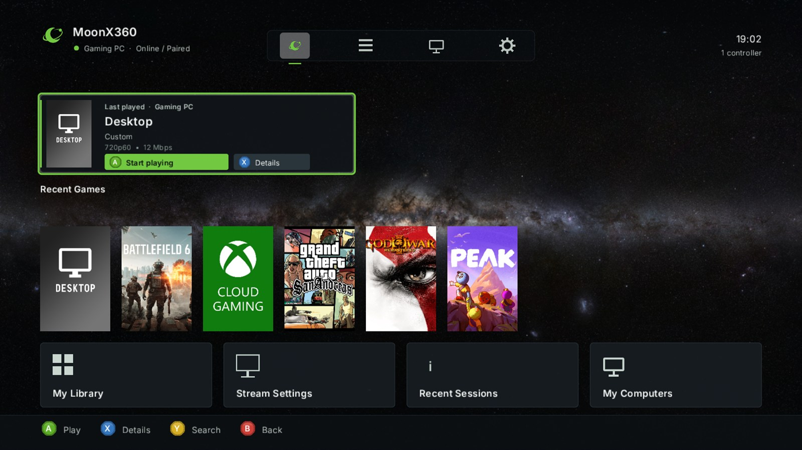
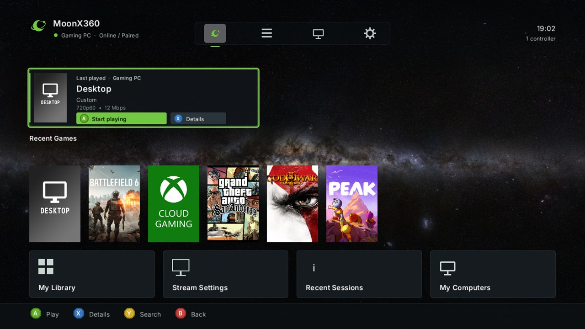
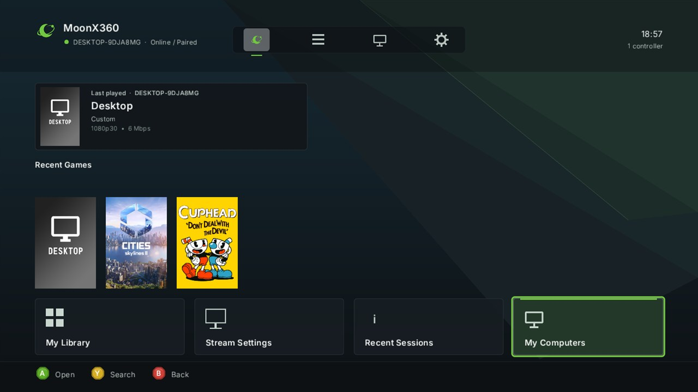
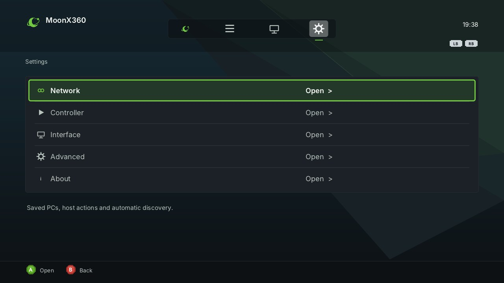
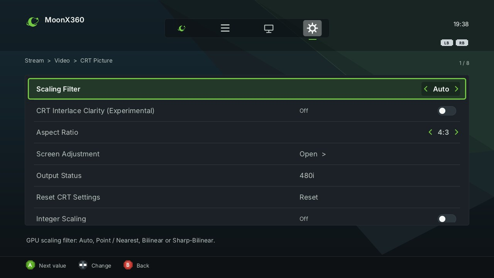
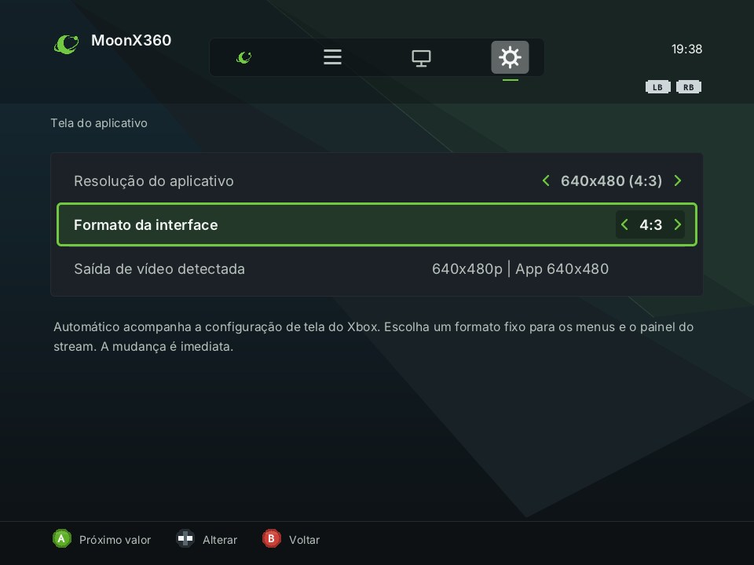
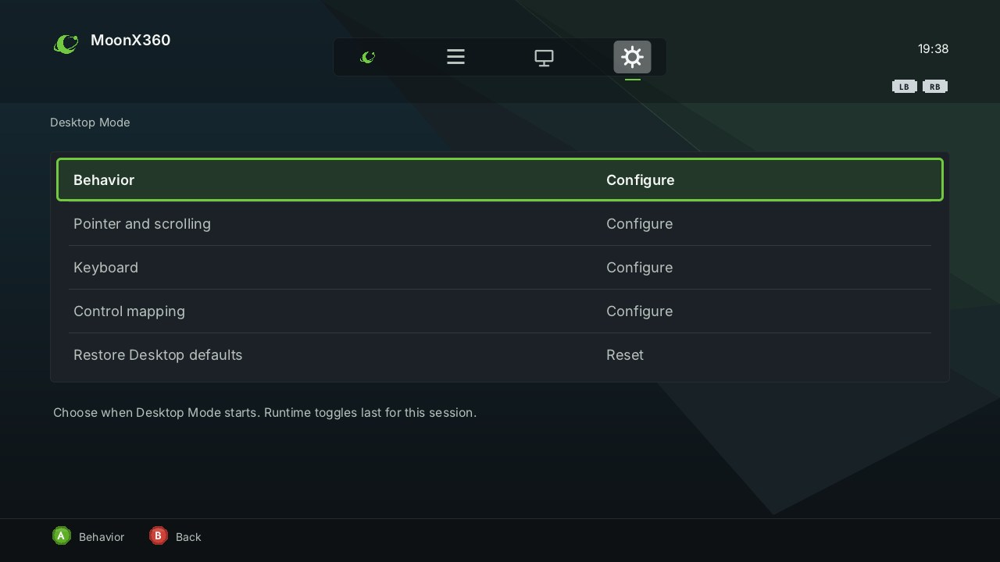
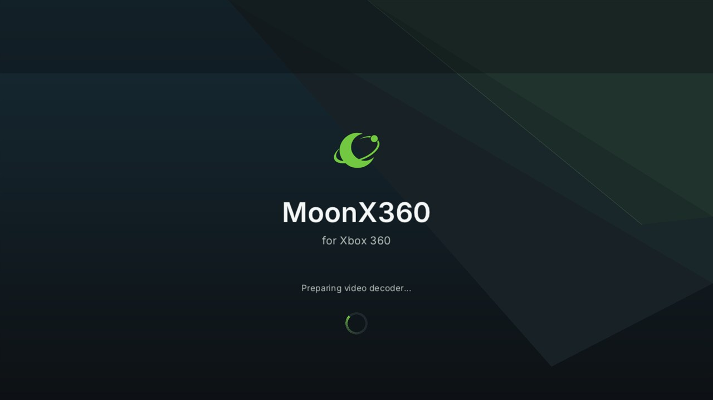
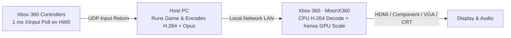

  

<h1 align="center">Your PC games. Your Xbox 360.</h1>

  

  
  
  
  
  
  

  <b>English</b> · <a href="README.pt-BR.md">Português (Brasil)</a> · <a href="README.es.md">Español</a>

  <a href="https://github.com/fransley2/MoonX360/releases"><b>Download</b></a> ·
  <a href="#installation-in-3-steps">Installation</a> ·
  <a href="#performance-results">Performance</a> ·
  <a href="#controls">Controls</a> ·
  <a href="#faq--troubleshooting">FAQ</a> ·
  <a href="https://github.com/fransley2/MoonX360/issues">Support &amp; Issues</a>

**MoonX360** is a native **Moonlight streaming client for Xbox 360**. Your games and apps run on a compatible host PC (using **Apollo**, **Sunshine**, or a GameStream-compatible server), while the Xbox 360 receives H.264 video and audio over your local network and sends controller input back to the PC. MoonX360 does **not** run modern PC games natively on Xbox 360 hardware.

---

## What's New in v0.2.6-rc1

> [!NOTE]
> `v0.2.6-rc1` is published as a **Pre-release** while final live reconnect smoke testing on the rebuilt `Final-release` XEX finishes. The previous stable release remains **`v0.2.5`**.

- **More responsive controller input under demanding workloads** — Pinned the `1 ms` XInput polling loop onto Xenon hardware thread `0`, cutting client-side input scheduling jitter P95 by ~80% during heavy 720p60 sessions.
- **Improved frame pacing & lower presentation latency** — Enabled `Latest Frame Wins` presentation by default, reducing Admission-to-VBlank P95 by ~13% with zero dropped frames across three 120-second validation runs.
- **Faster video texture uploads** — Contiguous YUV plane transfers with cache prefetch (`__dcbt` / `__dcbz128`) cut texture upload time by ~20.5% and trimmed peak decode spikes.
- **More efficient wired Ethernet packet handling** — Automatically uses `1392`-byte UDP packets on wired Ethernet at `>= 4 Mbps` while preserving `768`-byte packets for Wi-Fi.
- **Improved H.264 decoder consistency** — Adds optimized luma/chroma loop-filter and VMX1D chroma motion-compensation refinements on top of `batch16`, cutting steady-state decode P95 by ~4%.
- **Connection cleanup improvements** — Fixed `src/http.c` to send `Connection: close` and cleanly shut down TLS sockets immediately, preventing idle connections from wedging Apollo / Vibepollo / Sunshine port `47984`.
- **Xbox Series Dashboard, Smooth Desktop Mode & Smart Keyboard** — Updated Home, Library, Computers, and Settings with `2:3` portrait covers, spinning loaders, radial-deadzone mouse navigation at `125 Hz`, a 5-row PC Smart Virtual Keyboard, `Start + LB` PC Guide button emulation, **File Explorer 2.0**, and **CRT Retro 2.0** controls.

See [CHANGELOG.md](CHANGELOG.md) for the complete version history.

---

## Performance Results

Measured on a **physical Xbox 360** (`1280×720 @ 60 FPS`, **Apollo**, H.264, `CAVLC`, `8` slices, `10 Mbps`, full reference-frame deblocking, `VSync` enabled, three interleaved **120-second** sessions per build):

- **~80% lower** client input scheduling jitter P95 (`11.55 ms → 2.30 ms`)
- **~20% faster** YUV video texture upload (`1.14 ms → 0.91 ms` avg)
- **~13% lower** presentation latency (`32.03 ms → 27.89 ms` Admit-to-VBlank P95)
- **~4% lower** steady-state H.264 decode P95 (`14.95 ms → 14.37 ms`)
- **~59.5 presented FPS** at native `720p60` (`59.51` mean incl. startup)
- **0 dropped frames, 0 decoder errors, and 0 audio glitches** across all three final validation sessions (`Final-r1..r3`)

| Metric | Baseline | Optimized (`v0.2.6-rc1`) |
|---|---:|---:|
| Decode average *(45s steady-state)* | `13.22 ms` | **`12.94 ms`** |
| Decode P95 *(45s steady-state)* | `14.95 ms` | **`14.37 ms`** |
| Decode P99 *(45s steady-state)* | `15.15 ms` | **`14.67 ms`** |
| YUV upload average | `1.14 ms` | **`0.91 ms`** |
| Admit-to-VBlank P95 | `32.03 ms` | **`27.89 ms`** |
| Input scheduling jitter P95 | `11.55 ms` | **`2.30 ms`** |
| Presented FPS | `59.49` | **`59.51`** |

> [!IMPORTANT]
> - **Input jitter vs. total input lag:** `2.30 ms` P95 measures client-side **input scheduling jitter** (controller polling consistency), not total end-to-end button-to-photon latency.
> - **Contiguous YUV copy:** Contiguous planar uploads accelerate CPU-to-GPU memory transfer (`CPU_CACHED_TEXTURE`), **not** zero-copy decoding.
> - **Isolated FEC note:** Run `Final-r1` logged an isolated `11`-packet FEC deficit (`0` in `r2`/`r3`, `0` decode errors). On lossy LANs, you can switch back to `1024 B` packets in Settings.

Full methodology, sampling populations, and rejected experiments are documented in [docs/PERFORMANCE.md](docs/PERFORMANCE.md).

---

## Feature Highlights

<table>
  <tr>
    <td width="50%" valign="top">
      <h3>PC Game Streaming</h3>
      Stream Steam, Epic Games, Xbox PC Game Pass, GOG, emulators, and your Windows desktop from a compatible host PC.
    </td>
    <td width="50%" valign="top">
      <h3>Low-Latency Streaming</h3>
      Multi-threaded H.264 decoding with normative deblocking, HW0 input polling, contiguous YUV upload, and Latest-Frame-Wins presentation.
    </td>
  </tr>
  <tr>
    <td width="50%" valign="top">
      <h3>Native Xbox 360 Dashboard</h3>
      Controller-first <b>Home</b>, <b>Library</b>, <b>Computers</b>, and <b>Settings</b> views with 2:3 cover artwork, favorites, recent sessions, and custom wallpapers.
    </td>
    <td width="50%" valign="top">
      <h3>Streaming Profiles</h3>
      Factory presets (<b>Smooth</b>, <b>Performance</b>, <b>High Quality</b>, <b>Standard</b>, <b>Wireless Stable</b>, <b>CRT</b>, <b>1080p30</b>) plus per-game profiles.
    </td>
  </tr>
  <tr>
    <td width="50%" valign="top">
      <h3>CRT &amp; Retro Displays</h3>
      4:3 UI layout, CRT presets, scaling filters (Point, Bilinear, Sharp-Bilinear), screen position/overscan, and safe area. <b>240p</b> requires <code>480i</code> output plus an external <code>t240.xex</code> plugin.
    </td>
    <td width="50%" valign="top">
      <h3>Performance Overlay</h3>
      Toggleable <b>Basic</b>, <b>Detailed</b>, and <b>Developer</b> HUDs showing live FPS, decode latency, RTT, queue age, drops, and RTP/FEC counters.
    </td>
  </tr>
  <tr>
    <td width="50%" valign="top">
      <h3>Quick Menu</h3>
      Slide-out in-stream menu (<code>Back + L3</code>) for volume/mute, picture refresh, mouse mode, Smart Keyboard, overlay cycling, and disconnect.
    </td>
    <td width="50%" valign="top">
      <h3>Desktop Mode &amp; Smart Keyboard</h3>
      Smooth radial-deadzone analog mouse control, 5-row full PC virtual keyboard, offline autocomplete, and Xbox 360 USB keyboard support.
    </td>
  </tr>
  <tr>
    <td width="50%" valign="top">
      <h3>Aurora Direct Launch</h3>
      Generate standalone Aurora shortcuts (<code>MoonX360Shortcut</code>) to boot directly into specific PC games from Aurora's cover wall.
    </td>
    <td width="50%" valign="top">
      <h3>Host Compatibility &amp; Languages</h3>
      Works with <b>Sunshine</b>, <b>Apollo</b>, and GameStream forks. Interface available in <b>English</b>, <b>Español</b>, and <b>Português (Brasil)</b>.
    </td>
  </tr>
</table>

---

## Screenshots

<table>
  <tr>
    <td width="50%" align="center" valign="top">
      
       <b>Home Dashboard</b> (Xbox 360 hardware capture)
    </td>
    <td width="50%" align="center" valign="top">
      
       <b>Recent Games &amp; Computers</b> (Xbox 360 hardware capture)
    </td>
  </tr>
  <tr>
    <td width="50%" align="center" valign="top">
      
       <b>Live Stream &amp; Performance Overlay</b> (Xbox 360 hardware capture)
    </td>
    <td width="50%" align="center" valign="top">
      
       <b>Settings Menu</b> (PC UI preview)
    </td>
  </tr>
  <tr>
    <td width="50%" align="center" valign="top">
      
       <b>CRT Picture Controls</b> (PC UI preview)
    </td>
    <td width="50%" align="center" valign="top">
      
       <b>640×480 (4:3) Display Mode</b> (PC UI preview)
    </td>
  </tr>
  <tr>
    <td width="50%" align="center" valign="top">
      
       <b>Desktop Mode Options</b> (PC UI preview)
    </td>
    <td width="50%" align="center" valign="top">
      
       <b>Startup &amp; Decoder Init</b> (Xbox 360 hardware capture)
    </td>
  </tr>
</table>

---

## Hardware Compatibility

| Category | Item | Status | Notes |
|---|---|---|---|
| **Consoles** | Xbox 360 Slim / E (Corona) | **Tested by developer** | Primary hardware bench used for `v0.2.5` &amp; `v0.2.6` validation. |
| | Xbox 360 Slim (Trinity) | **Expected compatibility** | Standard XDK APIs; community reports welcome. |
| | Xbox 360 Fat (Jasper, Falcon, Zephyr, Xenon) | **Expected (untested in v0.2.6)** | No motherboard-specific hacks; not bench-tested in `v0.2.6`. |
| **Exploits** | RGH / JTAG (Aurora, FSD, XeXMenu) | **Tested by developer** | Requires writable HDD or USB storage for `moonlight/`. |
| | BadUpdate / XeUnshackle | **Not yet tested** | Uses retail-compatible XDK imports; expected to run where XEX homebrew works. |
| **Video Outputs** | HDMI (`720p` / `1080p`) | **Tested by developer** | `720p` recommended for 60 FPS; `1080p` supported for UI &amp; experimental `1080p30`. |
| | Component / VGA (`480p` / `720p` / `640×480`) | **Expected compatibility** | Supports `4:3` UI layout and `CRT Picture` controls. |
| | CRT / SDTV (`480i` 4:3) | **Tested (v0.2.5) / Supported** | Rec.601 color matrix, scaling filters, overscan, and safe area. |
| | CRT Retro (`240p`) | **Requires external plugin** | Needs `480i/60 Hz` output + external `t240.xex` DashLaunch plugin (falls back to `480p`/`480i` on HD). |
| **Network** | Wired Ethernet (`100 Mbps`) | **Tested by developer (Recommended)** | Recommended for steady `720p60`; auto-uses `1392 B` packets at `>= 4 Mbps`. |
| | Wi-Fi | **Known limitations** | Higher jitter/loss on Xbox 360 wireless; use the **Wireless Stable** preset. |

See [docs/COMPATIBILITY.md](docs/COMPATIBILITY.md) for the full compatibility matrix and community report instructions.

---

## Installation in 3 Steps

### Step 1 — Prepare your PC
Install [**Apollo**](https://github.com/ClassicOldSong/Apollo) or [**Sunshine**](https://github.com/LizardByte/Sunshine) on your PC, enable **H.264** streaming, and install **ViGEmBus** on Windows if required for virtual Xbox 360 controller emulation.

### Step 2 — Install MoonX360
Download **`MoonX360-v0.2.6-rc1.zip`** (or standalone **`default.xex`**) and **`SHA256SUMS.txt`** from [**GitHub Releases**](https://github.com/fransley2/MoonX360/releases), verify the SHA-256 checksum, copy the `MoonX360` folder (`default.xex` plus optional `MoonX360Shortcut\` and `AuroraScripts\`) to `Hdd1:\Apps\MoonX360\` or USB storage, and launch **`default.xex`** via Aurora, FSD, or XeXMenu.

### Step 3 — Pair and play
Open **Computers**, select your discovered PC (or add its LAN IP manually), choose **Pair with host**, and enter the 4-digit PIN in your PC host Web UI. Open **Library** and press **A** on any game or **Desktop** to start streaming.

> [!TIP]
> **Updating without losing data:** Keep your existing **`moonlight/`** folder next to `default.xex`. It stores `moonlight.ini`, `hosts.tsv`, profiles, and pairing keys (`client.pem` / `key.pem`). Never share those files publicly.

---

## Recommended Streaming Settings

All values below match the production configuration in [`src/config.c`](src/config.c):

| Preset | Stream Resolution | Target FPS | Bitrate | VSync | Intended Use |
|---|---|---:|---:|---|---|
| **Smooth** *(Default)* | `1280×720` | `60` | `6 Mbps` | On | Everyday balanced 720p60 on wired Ethernet. |
| **Performance** | `960×540` | `60` | `5 Mbps` | On | Extra 60 FPS CPU headroom (GPU-upscaled by Xenos). |
| **High Quality (Experimental)** | `1280×720` | `60` | `12 Mbps` | On | Higher-detail 720p60 on wired LAN; 60 FPS not guaranteed in heavy scenes. |
| **Standard** | `1280×720` | `30` | `6 Mbps` | On | Maximum decode headroom & consistent 30 FPS pacing. |
| **1080p30 (Experimental)** | `1920×1080` | `30` | `10 Mbps` | On | Desktop & low-motion 1080p30 viewing. |
| **Wireless Stable** | `854×480` | `60` | `4 Mbps` | Off | Wi-Fi stability (`768 B` UDP packets, full deblocking). |
| **CRT** | `640×480` | `60` | `3 Mbps` | Off | `4:3` CRT TV / VGA / SDTV setups (Rec.601 color). |
| **CRT Retro (240p)** | `640×240` | `60` | `3 Mbps` | On | Point/Nearest `240p` on `480i` + external `t240.xex` plugin. |

> **Stream vs. Display Resolution:** Stream resolution is what your PC encodes; your Xbox 360 console dashboard output (`480i`, `480p`, `720p`, `1080p`) is configured in the Xbox 360 system settings (and scaled by the Xenos GPU).

---

## Controls

| Context | Combo / Button | Action |
|---|---|---|
| **In-Stream** | `Back + L3` | Open / close **Quick Menu** |
| | `Back + R3` | Toggle **Desktop / Mouse Mode** |
| | `LB + RB + L3 + R3` *(hold 2 s)* | **Disconnect** and return to MoonX360 (alternative `Back + Start + LB + RB` in Settings) |
| | `Start + LB` *(hold 350 ms)* | **PC Guide Button** (`SPECIAL_FLAG` for Steam / Xbox Game Bar) |
| | `Back + LB + RB + X` | Cycle **Performance Overlay** (`Off` → `Basic` → `Detailed` → `Developer`) |
| | Quick Menu → `Refresh picture` | Request immediate **Picture Refresh** (IDR keyframe) |
| | Quick Menu → `Y` or `Keyboard` | Open **Smart Virtual Keyboard** |
| **Dashboard / Library** | `LB` / `RB` | Switch tabs (**Home** / **Library** / **Computers** / **Settings**) |
| | `A` / `X` / `Y` / `Start` | Play or Open / Game Details & Aurora Shortcut / Search or Refresh / Library Menu |

See [docs/CONTROLS.md](docs/CONTROLS.md) for full Desktop Mode and Aurora shortcut controls.

---

## How It Works

1. **PC-side rendering & encoding:** Your host PC runs the game and encodes H.264 video and Opus audio via Sunshine or Apollo.
2. **H.264 network streaming:** UDP RTP packets with `nanors` FEC travel over your LAN (`1392 B` wired at `>= 4 Mbps`, `768 B` Wi-Fi).
3. **Xbox 360 CPU decoding:** FFmpeg `1.2.12` decodes H.264 slices across 4 Xenon worker threads with normative cross-slice deblocking.
4. **Xenos GPU presentation:** Contiguous Y/U/V copies feed a 3-slot `CPU_CACHED_TEXTURE` pipeline, with HLSL color conversion and `Latest Frame Wins` pacing.
5. **Audio playback:** Opus audio is decoded and played through XAudio2 (`Stereo` default with `5.1` option).
6. **Controller return path:** A dedicated `1 ms` thread on HW0 polls up to 4 controllers (plus USB keyboards) and sends input back over ENet/UDP.

Technical subsystem details are in [docs/ARCHITECTURE.md](docs/ARCHITECTURE.md).

---

## FAQ & Troubleshooting

<b>Does the PC need to stay on? Does MoonX360 run PC games natively?</b>

Your PC must stay turned on because it runs the game and encodes the stream. MoonX360 does **not** run PC games natively on Xbox 360.

<b>Can I play Steam, Epic Games, or Xbox PC titles? Does it work with a mobile phone?</b>

Yes—any game or app your PC host (Sunshine/Apollo) can launch or capture works, including Steam, Epic Games, Xbox PC Game Pass, emulators, and Desktop. A compatible PC host is required; a mobile phone running standard Moonlight cannot act as the host.

<b>Does it require Xbox Live? Can I stream over the internet or Wi-Fi?</b>

Xbox Live is **not** required. MoonX360 is designed for **local network (LAN)** use; internet streaming is unsupported. Wired Ethernet is recommended; for Wi-Fi, use **Wireless Stable**.

<b>Can I use a CRT TV? Can the Xbox 360 display 1080p60 streams?</b>

Yes—`CRT` (`640×480`) works on `480i`/`480p`/VGA displays, and `CRT Retro (240p)` works on `480i` with an external `t240.xex` plugin ([docs/CRT.md](docs/CRT.md)). `1080p60` is **not** supported by the CPU decoder; `720p60` is the primary 60 FPS target and `1080p` is limited to experimental `30 FPS`.

<b>Why does my stream stutter, controller stop responding, or pairing fail?</b>

- **Stutter with `0` drops:** Run your PC game fullscreen so Windows WGC capture does not throttle unfocused desktop frames.
- **Controller unresponsive:** Ensure **Desktop Mode** (`Back + R3`) is Off during gameplay and **ViGEmBus** is installed on Windows.
- **Pairing fails:** Enable **H.264** on the host, allow **TCP `47984/47989/48010`** and **UDP `47998–48010`** in Windows Firewall, or run **Computers → Host → Connection test**.

**Reporting bugs:** Open an issue in [GitHub Issues](https://github.com/fransley2/MoonX360/issues) with your **Xbox 360 model**, **MoonX360 version**, **host software**, **Wired/Wi-Fi**, **stream settings**, and logs. **Never upload `client.pem`, `key.pem`, or `hosts.tsv`.**

Full guides: [docs/FAQ.md](docs/FAQ.md) · [docs/TROUBLESHOOTING.md](docs/TROUBLESHOOTING.md)

---

## Known Limitations & Roadmap

- **H.264 Only:** HEVC (H.265), AV1, and HDR are unsupported on Xbox 360.
- **CPU Decode Budget:** `720p60` fits cleanly around `6–10 Mbps`; `12 Mbps` (`High Quality`) and `1080p30` are experimental.
- **Host WGC Throttling:** Non-fullscreen Windows captures can throttle host frame delivery even with `0` client drops.
- **CRT 240p:** Requires `480i/60 Hz` output and an external `t240.xex` plugin.
- **Pre-release Status (`v0.2.6-rc1`):** The optimization stack (`E5b+E7+E8+E9`) passed three 120s hardware runs and `Final-release/default.xex` booted cleanly on physical hardware, while final automated post-rebuild live reconnect smoke testing was blocked by a wedged `ApolloService` TLS socket.

**Roadmap:** Complete final `v0.2.6` live reconnect validation, expand community Fat/Trinity/BadUpdate hardware reports, and continue separate research into GPU-assisted video decoding (not available in this release).

---

## Credits, Privacy & Licensing

- **License:** [GNU General Public License v3.0 (GPLv3)](LICENSE).
- **Credits:** Built upon [Xenonlight](https://github.com/roderick-neuhoff/Xenonlight) and [Moonlight](https://moonlight-stream.org/) (`moonlight-common-c`), using **FFmpeg 1.2.12**, **Mbed TLS 2.16.12**, **Opus 1.5.2**, **stb**, and **Inter** fonts. Full notices: [THIRD_PARTY_NOTICES.md](THIRD_PARTY_NOTICES.md) and [docs/DEPENDENCIES.md](docs/DEPENDENCIES.md).
- **Privacy:** MoonX360 communicates only on your local network with the GameStream hosts you configure. No analytics or telemetry are sent externally; optional session logs are written locally on console storage only when enabled by the user.
- **AI-assisted development:** AI tooling assisted with portions of code, refactoring, and documentation; all changes were human-reviewed and validated via automated host regression suites and physical Xbox 360 testing.
- **Disclaimer:** MoonX360 is an independent homebrew project with no affiliation to Microsoft, Xbox, NVIDIA, Valve, or Moonlight. Homebrew software is provided *"as is"* under GPLv3—use on modified consoles is at your own risk.

<b>If MoonX360 brought PC gaming to your Xbox 360, consider leaving a ⭐ on the repository.</b>

