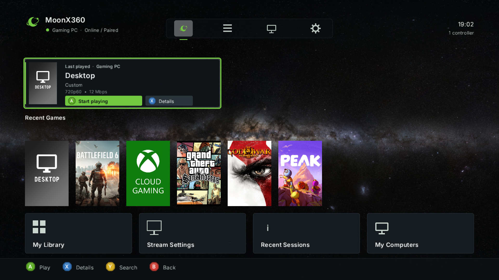
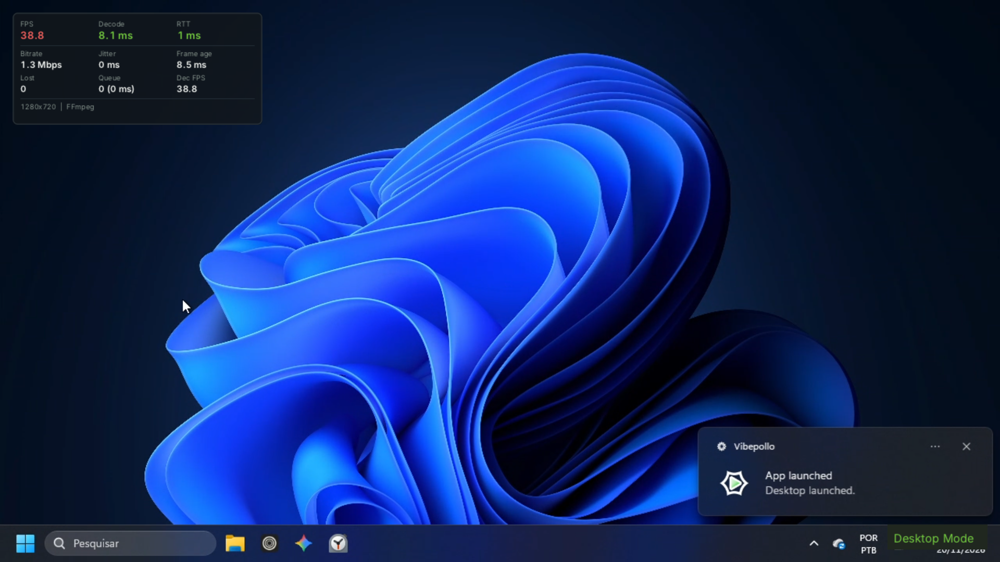
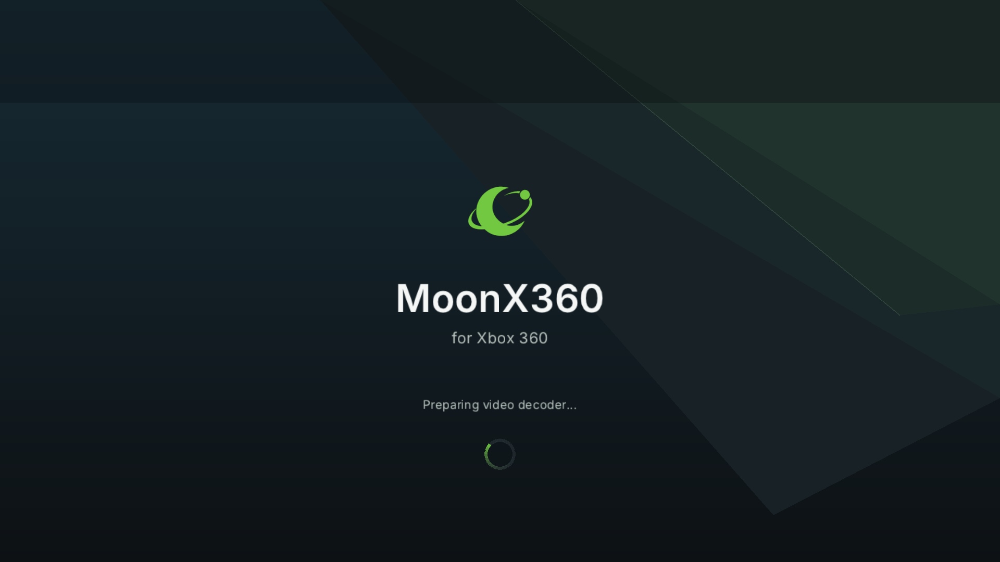

<p align="center">
  
</p>

# MoonX360

MoonX360 is a native Xbox 360 client for streaming PC games and desktop apps from [Sunshine](https://github.com/LizardByte/Sunshine), [Apollo](https://github.com/ClassicOldSong/Apollo), or a compatible GameStream host.

[](https://github.com/fransley2/MoonX360/releases/latest)
[](LICENSE)
[](#requirements)

[Download](#download) · [Installation](#installation) · [Recommended Settings](#recommended-settings) · [Build from Source](#building-from-source)

---

## Features

- **Controller-First Dashboard** — Native **Home**, **Library**, **Computers**, and **Settings** views with 2:3 portrait cover artwork, recent sessions, favorites, and custom PNG/JPEG home wallpapers.
- **Batch16 Parallel H.264 Decoder** — Adapted Xbox 360 FFmpeg H.264 pipeline with 16-slice batch capacity across 4 persistent Xenon worker threads, VMX128 motion compensation and loop-filter kernels, and wavefront normative across-slice deblocking.
- **Cached GPU Texture Pipeline** — 3-slot `CPU_CACHED_TEXTURE` linear plane transfer (`D3DFMT_LIN_L8`) with explicit D3D9 GPU fences and latest-only frame presentation.
- **Low-Latency Controller & Desktop Mode** — Dedicated controller input polling (`LOW_LATENCY_INPUT=1`), controller mouse emulation, and an on-screen **Smart Keyboard** (compact search keyboard with local English, Brazilian Portuguese, and Spanish suggestions, plus a full 5-row PC keyboard for remote desktop sessions).
- **In-Stream Quick Menu & Performance Overlay** — Press **Back + L3** during a stream to open the Quick Menu, request a picture refresh, toggle mouse mode, adjust volume, switch apps, or enable the **Basic**, **Detailed**, or **Developer** Performance Overlay.
- **CRT & 4:3 Display Support** — Dedicated **CRT (`640×480`)** profile and **CRT Picture** controls for 4:3 aspect ratio, scaling filter (`Auto`, `Point / Nearest`, `Bilinear`, `Sharp-Bilinear`), screen position adjustment (`±20 px`), and UI safe area. Optional **CRT Retro (`640×240`)** integration for setups running 480i output with an external `t240.xex` plugin.
- **Aurora Direct Launch Shortcuts** — Create per-game shortcut folders that launch a paired PC app directly from the Aurora dashboard via `MoonX360Shortcut`.

---

## Screenshots

Captured directly from an Xbox 360 hardware front-buffer (`1920×1080` output):

<p align="center">
  
</p>
<p align="center">
  <em>Home dashboard with recent games, 2:3 cover artwork, and quick navigation tiles.</em>
</p>

<p align="center">
  
</p>
<p align="center">
  <em>Live 720p60 PC desktop stream on Xbox 360 with the Detailed Performance Overlay and Desktop Mode active.</em>
</p>

<p align="center">
  
</p>
<p align="center">
  <em>Startup and decoder initialization screen.</em>
</p>

---

## Download

Download the latest **`default.xex`** executable and **`SHA256SUMS.txt`** from [**GitHub Releases**](https://github.com/fransley2/MoonX360/releases/latest).

Always verify the SHA-256 checksum of `default.xex` against `SHA256SUMS.txt` before transferring it to your console.

---

## Installation

### Requirements

- An **RGH or JTAG Xbox 360** with DashLaunch configured to run homebrew XEX executables.
- A PC running **Sunshine**, **Apollo**, or a compatible GameStream host on the same local network, with **H.264** encoding enabled.
- A writable folder on the Xbox 360 **HDD** or **USB** storage.

### Steps

1. Copy **`default.xex`** from the [latest release](https://github.com/fransley2/MoonX360/releases/latest) to a writable directory on your console, such as `Hdd1:\Apps\MoonX360\default.xex`.
2. Launch **`default.xex`** from Aurora, FSD, or XeXMenu.
3. Open **My Computers** to select an automatically discovered PC (or add its IP address manually), choose **Pair with host**, and enter the 4-digit PIN on your PC.
4. Open **My Library** and press **A** on any game or **Desktop** to start streaming.
5. During a stream:
   - Press **Back + L3** to open the in-stream **Quick Menu**.
   - Hold **LB + RB + L3 + R3** (default shortcut) to disconnect and return to MoonX360.

> **Updating:** Keep the **`moonlight/`** folder next to `default.xex` when updating. It stores your saved settings (`moonlight.ini`), paired hosts (`hosts.tsv`), user profiles, and pairing certificates (`client.pem` / `key.pem`). Back up `moonlight/` before downgrading to an older release.

---

## Recommended Settings

MoonX360 includes factory stream presets tuned for the Xbox 360 CPU's H.264 decoding budget:

| Preset | Resolution & Target FPS | Bitrate | Best For |
|---|---|---|---|
| **Smooth** *(Default)* | `1280×720` @ `60 FPS` | `6 Mbps` | Low-latency 720p60 gaming over wired Ethernet with full normative H.264 deblocking headroom. |
| **Maximum Quality** | `1280×720` @ `60 FPS` | `10 Mbps` | Higher image fidelity at 720p60 on wired networks. |
| **Standard** | `1280×720` @ `30 FPS` | `6 Mbps` | Maximum decoding headroom and consistent 30 FPS pacing. |
| **Performance** | `960×540` @ `60 FPS` | `3 Mbps` | High-motion 60 FPS scenes upscaled to the console output by the Xenos GPU. |
| **Wireless Stable** | `854×480` @ `60 FPS` | `2 Mbps` | Wi-Fi connections (uses 768-byte RTP packets and VSync Off to reduce packet burst stalls). |
| **CRT** | `640×480` @ `60 FPS` | `3 Mbps` | 4:3 CRT displays and SDTV/VGA setups with Rec.601 color and CRT Picture scaling controls. |
| **1080p (Experimental)** | `1920×1080` @ `30 FPS` | `8 Mbps` | Low-motion 1080p30 content and desktop viewing. |

---

## Building from Source

Build on Windows with **Python 3**, **Git**, and a separately obtained **Xbox 360 SDK 21256.3** (with the `TechPreview\Jul12Compiler` toolchain). The repository includes the adapted FFmpeg 1.2.12, Moonlight common C, Mbed TLS 2.16.12, and Opus 1.5.2 source snapshots under `xdk/deps/`.

To build the **Best Performance** release configuration (`Release/aggressive`, 10 FFmpeg `batch16` patches, and `LOW_LATENCY_INPUT=1`) into a fresh output directory:

```powershell
$env:XEDK = 'C:\Program Files (x86)\Microsoft Xbox 360 SDK'
python xdk\scripts\build_best_performance.py --out xdk\build-best-performance
```

The resulting executable is written to **`xdk\build-best-performance\default.xex`** (and the optional Aurora shortcut launcher to **`xdk\build-best-performance\MoonX360Shortcut\default.xex`**).

To run the automated host regression test suites on Windows (requires Visual Studio C++ Build Tools / MSVC):

```powershell
python xdk\tests\run_host_tests.py
python xdk\tests\run_expansion_tests.py
python xdk\tests\run_vmx_mc_tests.py
```

See the [build guide](docs/BUILD.md) for detailed build commands, [Aurora shortcuts](docs/AURORA_DIRECT_LAUNCH.md) for direct game launcher setup, and [dependency provenance](docs/DEPENDENCIES.md) for source boundaries.

---

## Known Limitations

- **CPU H.264 Decoding Budget:** H.264 decoding runs on the Xbox 360 PowerPC Xenon CPU with normative in-loop deblocking enabled to prevent reference drift. At `720p60`, bitrates above `10–12 Mbps` approach the `16.67 ms` per-frame budget; use **Smooth (`6 Mbps`)** or **Maximum Quality (`10 Mbps`)** for 60 FPS gaming, or **Standard (`720p30`)** for heavy scenes.
- **Codec Support:** Only **H.264 (AVC)** is supported. HEVC (H.265), AV1, and HDR are unsupported on Xbox 360 hardware.
- **1080p is Experimental:** `1920×1080` is limited to `30 FPS` (`8 Mbps` preset) and is intended for desktop or low-motion content.
- **CRT Retro (240p):** The `CRT Retro (240p)` profile (`640×240`) requires the console to be configured for `480i/60 Hz` SD output and an external compatible `t240.xex` plugin loaded via DashLaunch. On HDMI/HD video modes, MoonX360 automatically blocks 240p mode and offers a safe fallback to standard **CRT (`640×480`)**.

---

## Credits & License

MoonX360 builds on [Xenonlight](https://github.com/roderick-neuhoff/Xenonlight) and [Moonlight](https://moonlight-stream.org/) (`moonlight-common-c`).

- Application license: **[GNU GPLv3](LICENSE)**
- Third-party dependency notices and attributions: **[THIRD_PARTY_NOTICES.md](THIRD_PARTY_NOTICES.md)** and **[docs/DEPENDENCIES.md](docs/DEPENDENCIES.md)**

[Logo](docs/images/logo.png) · [Icon](docs/images/icon.png) · [Banner](docs/images/banner.png) · [Social Preview](docs/images/social-preview.png)
