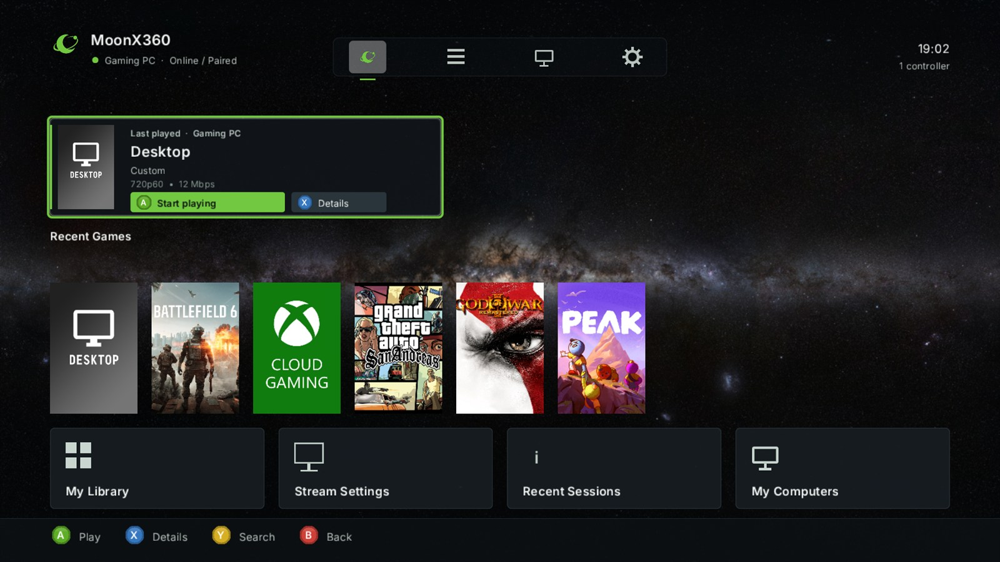
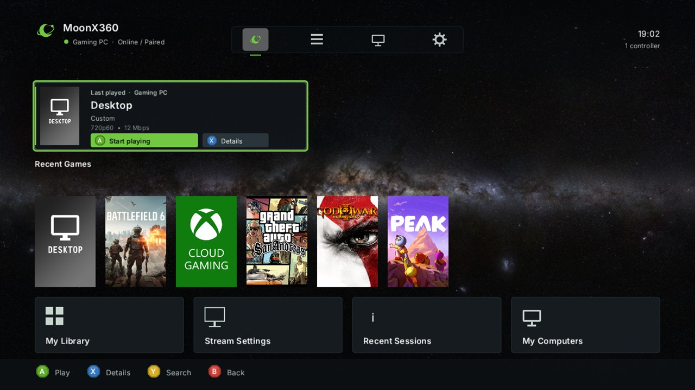
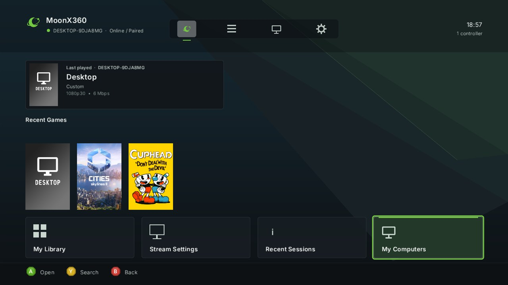
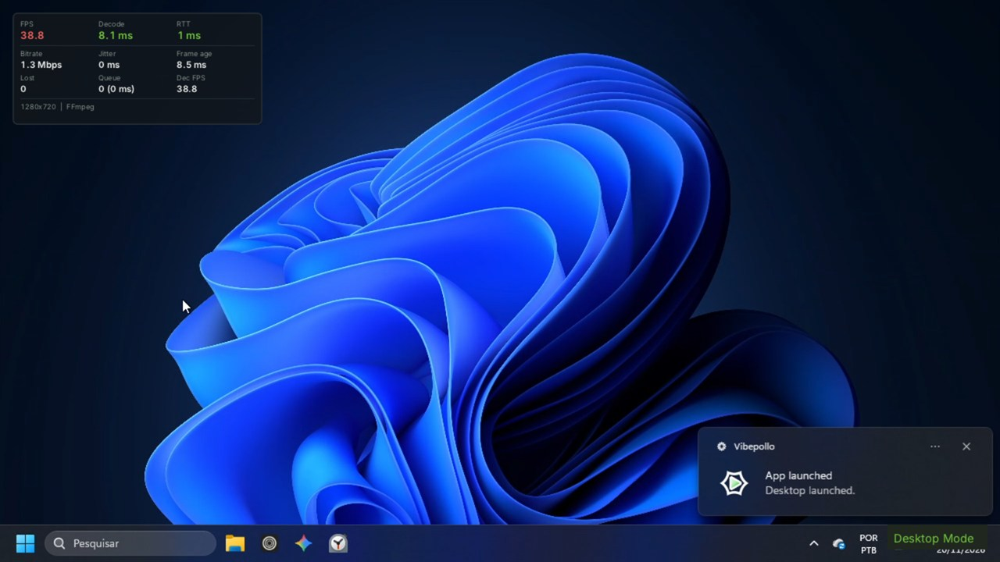
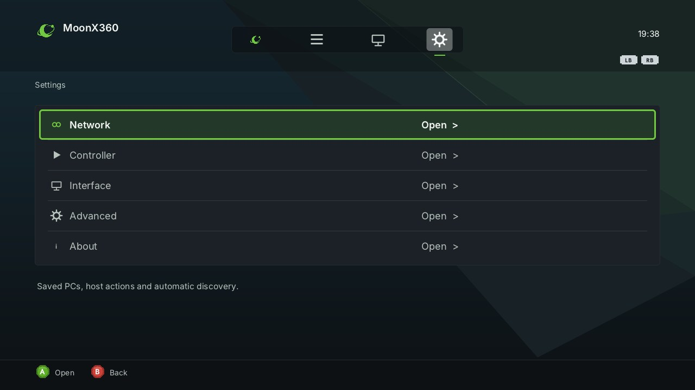
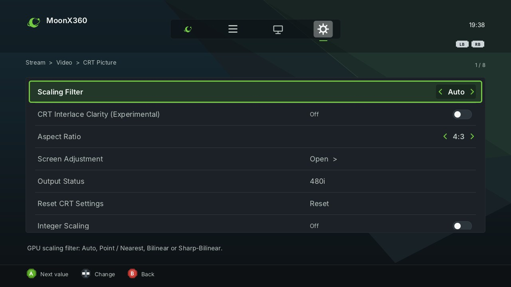
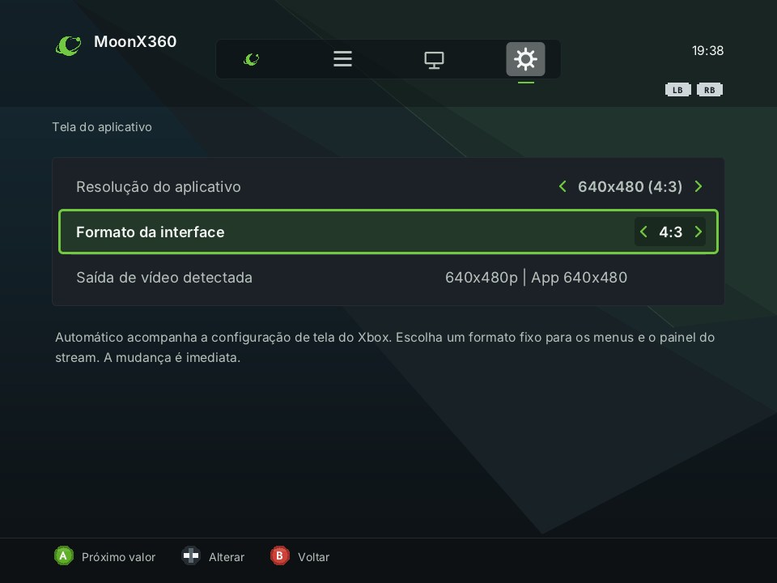
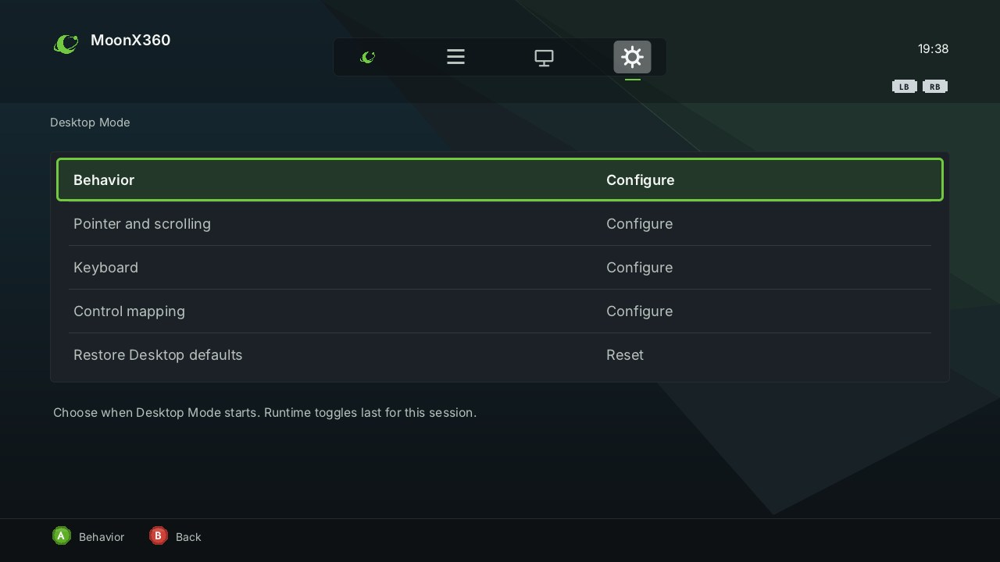
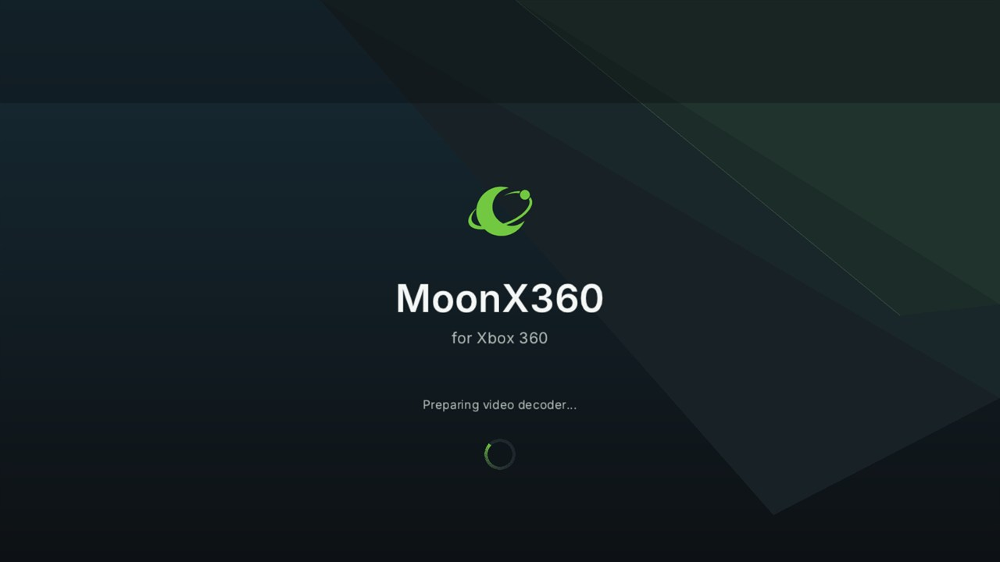
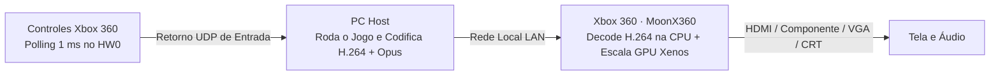

  

<h1 align="center">Seus jogos de PC. Seu Xbox 360.</h1>

  

  
  
  
  
  
  

  <a href="README.md">English</a> · <b>Português (Brasil)</b> · <a href="README.es.md">Español</a>

  <a href="https://github.com/fransley2/MoonX360/releases"><b>Download</b></a> ·
  <a href="#instalação-em-3-passos">Instalação</a> ·
  <a href="#resultados-de-desempenho">Desempenho</a> ·
  <a href="#controles">Controles</a> ·
  <a href="#faq-e-solução-de-problemas">FAQ</a> ·
  <a href="https://github.com/fransley2/MoonX360/issues">Suporte e Issues</a>

O **MoonX360** é um cliente nativo de **streaming Moonlight para Xbox 360**. Seus jogos e aplicativos rodam em um PC compatível (com **Apollo**, **Sunshine** ou servidor GameStream compatível), enquanto o Xbox 360 recebe vídeo H.264 e áudio pela rede local e envia os comandos do controle de volta ao PC. O MoonX360 **não** executa jogos modernos de PC nativamente no hardware do Xbox 360.

---

## Novidades da v0.2.6

- **Controles mais responsivos sob carga pesada** — A thread de leitura XInput (`1 ms`) foi fixada no núcleo de hardware `0` do Xenon (`E7`), reduzindo em ~80% o jitter de agendamento de entrada em P95 durante sessões 720p60 exigentes.
- **Ritmo de quadros aprimorado e menor latência de apresentação** — O modo `Latest Frame Wins` (`E9`) agora vem ativado por padrão, reduzindo o tempo Admit-to-VBlank P95 em ~13% com zero quadros descartados em três sessões de validação de 120 segundos.
- **Upload de texturas de vídeo mais rápido** — Transferências contíguas de planos YUV com pré-busca de cache (`E5b`, `__dcbt` / `__dcbz128`) reduzem o tempo de upload em ~20,5% e atenuam picos de decodificação.
- **Manuseio mais eficiente de pacotes Ethernet cabeados** — Usa automaticamente pacotes UDP de `1392 bytes` em rede cabeada a partir de `4 Mbps` (`E8`), preservando pacotes de `768 bytes` para Wi-Fi.
- **Maior consistência no decodificador H.264** — Adiciona otimizações de loop-filter luma/chroma e compensação de movimento chroma VMX1D (`v026-rc2`) sobre o pipeline `batch16`, reduzindo o decode P95 em regime estável em ~4%.
- **`default.xex` em arquivo único e Atualização Automática assinada** — Distribuição simplificada em um único `default.xex` permanente (**Configurações → Geral → Atualizações do app**) com verificação Ed25519 + SHA-256, HTTPS TLS 1.2 validado, canais **Estável** / **Beta**, reversão automática em falhas, recuperação via `LB + RB + Back` e preservação integral da pasta `moonlight/`.
- **Correções de encerramento de conexão** — O `src/http.c` volta a enviar `Connection: close` e fecha imediatamente o socket TLS, evitando conexões ociosas que travavam a porta `47984` do Apollo / Vibepollo / Sunshine.
- **Dashboard estilo Xbox Series, Modo Desktop suave e Smart Keyboard** — Telas Início, Biblioteca, Computadores e Configurações redesenhadas com capas `2:3`, indicadores giratórios, mouse analógico com zona morta radial a `125 Hz`, teclado virtual completo de 5 linhas, botão **PC Guide** (`Start + LB`), **Explorador de Arquivos 2.0** e **CRT Retro 2.0**.

Veja o histórico completo em [CHANGELOG.md](CHANGELOG.md).

---

## Resultados de Desempenho

Medições em **Xbox 360 físico** (`1280×720 @ 60 FPS`, **Apollo**, H.264, `CAVLC`, `8` slices, `10 Mbps`, deblocking completo de quadros de referência, `VSync` ativado, três sessões intercaladas de **120 segundos** por configuração):

- **~80% menor** jitter de agendamento de entrada P95 (`11,55 ms → 2,30 ms`)
- **~20% mais rápido** o upload de texturas YUV (`1,14 ms → 0,91 ms` na média)
- **~13% menor** latência de apresentação (`32,03 ms → 27,89 ms` Admit-to-VBlank P95)
- **~4% menor** decode H.264 P95 em regime estável (`14,95 ms → 14,37 ms`)
- **~59,5 FPS apresentados** em `720p60` nativo (`59,51` de média incluindo inicialização)
- **0 quadros descartados, 0 erros de decodificação e 0 falhas de áudio** nas três sessões finais de validação (`Final-r1..r3`)

| Métrica | Baseline | Otimizado (`v0.2.6`) |
|---|---:|---:|
| Média de decode *(janela estável 45s)* | `13,22 ms` | **`12,94 ms`** |
| Decode P95 *(janela estável 45s)* | `14,95 ms` | **`14,37 ms`** |
| Decode P99 *(janela estável 45s)* | `15,15 ms` | **`14,67 ms`** |
| Média de upload YUV | `1,14 ms` | **`0,91 ms`** |
| Admit-to-VBlank P95 | `32,03 ms` | **`27,89 ms`** |
| Jitter de agendamento de entrada P95 | `11,55 ms` | **`2,30 ms`** |
| FPS apresentados | `59,49` | **`59,51`** |

> [!IMPORTANT]
> - **Jitter de entrada vs. latência total até a tela:** `2,30 ms` P95 mede o **jitter de agendamento de entrada no cliente** (regularidade do polling do controle), não a latência total do botão até o pixel na TV.
> - **Cópia YUV contígua:** A transferência planar contígua acelera a cópia CPU→GPU (`CPU_CACHED_TEXTURE`), **não** se tratando de decodificação zero-copy.
> - **Nota isolada de FEC:** A execução `Final-r1` registrou um déficit isolado de `11` pacotes FEC (`0` em `r2`/`r3`, `0` erros de decodificação). Em redes com perda de pacotes, você pode voltar para `1024 B` nas Configurações.

Metodologia completa, populações de amostragem e experimentos rejeitados em [docs/PERFORMANCE.md](docs/PERFORMANCE.md).

---

## Principais Recursos

<table>
  <tr>
    <td width="50%" valign="top">
      <h3>Streaming de Jogos de PC</h3>
      Jogue títulos do Steam, Epic Games, Xbox PC Game Pass, GOG, emuladores e sua área de trabalho do Windows a partir de um PC compatível.
    </td>
    <td width="50%" valign="top">
      <h3>Streaming de Baixa Latência</h3>
      Decodificação H.264 paralela com deblocking normativo, polling em HW0, upload YUV contíguo e apresentação Latest-Frame-Wins.
    </td>
  </tr>
  <tr>
    <td width="50%" valign="top">
      <h3>Dashboard Nativo do Xbox 360</h3>
      Telas <b>Início</b>, <b>Biblioteca</b>, <b>Computadores</b> e <b>Configurações</b> com capas 2:3, favoritos, sessões recentes e papéis de parede.
    </td>
    <td width="50%" valign="top">
      <h3>Perfis de Transmissão</h3>
      Perfis pré-configurados (<b>Smooth</b>, <b>Performance</b>, <b>High Quality</b>, <b>Standard</b>, <b>Wireless Stable</b>, <b>CRT</b>, <b>1080p30</b>) e perfis por jogo.
    </td>
  </tr>
  <tr>
    <td width="50%" valign="top">
      <h3>TVs CRT e Telas Retrô</h3>
      Interface 4:3, perfis CRT, filtros de escala (Point, Bilinear, Sharp-Bilinear), ajuste de posição/overscan e área segura. Modo <b>240p</b> requer saída <code>480i</code> e plugin externo <code>t240.xex</code>.
    </td>
    <td width="50%" valign="top">
      <h3>Painel de Desempenho</h3>
      Overlay nos modos <b>Básico</b>, <b>Detalhado</b> e <b>Desenvolvedor</b> exibindo FPS, tempo de decode, RTT, fila, descartes e contadores RTP/FEC.
    </td>
  </tr>
  <tr>
    <td width="50%" valign="top">
      <h3>Menu Rápido</h3>
      Menu deslizante durante o jogo (<code>Back + L3</code>) para volume/mudo, atualização de imagem, modo mouse, Smart Keyboard, overlay e desconexão.
    </td>
    <td width="50%" valign="top">
      <h3>Modo Desktop e Smart Keyboard</h3>
      Mouse suave por analógico com zona morta radial, teclado virtual PC completo de 5 linhas com sugestões offline e suporte a teclado USB do Xbox 360.
    </td>
  </tr>
  <tr>
    <td width="50%" valign="top">
      <h3>Atalhos Diretos no Aurora</h3>
      Crie atalhos diretos (<code>MoonX360Shortcut</code>) para abrir jogos específicos do PC diretamente pela grade do Aurora.
    </td>
    <td width="50%" valign="top">
      <h3>Compatibilidade e Idiomas</h3>
      Compatível com <b>Sunshine</b>, <b>Apollo</b> e derivados do GameStream. Interface traduzida em <b>Inglês</b>, <b>Espanhol</b> e <b>Português (Brasil)</b>.
    </td>
  </tr>
</table>

---

## Capturas de Tela

<table>
  <tr>
    <td width="50%" align="center" valign="top">
      
       <b>Tela Inicial (Home)</b> (Captura real em hardware Xbox 360)
    </td>
    <td width="50%" align="center" valign="top">
      
       <b>Jogos Recentes e Computadores</b> (Captura real em hardware Xbox 360)
    </td>
  </tr>
  <tr>
    <td width="50%" align="center" valign="top">
      
       <b>Transmissão ao Vivo e Painel de Desempenho</b> (Captura real em hardware Xbox 360)
    </td>
    <td width="50%" align="center" valign="top">
      
       <b>Menu de Configurações</b> (Prévia de UI no PC)
    </td>
  </tr>
  <tr>
    <td width="50%" align="center" valign="top">
      
       <b>Controles de Imagem CRT</b> (Prévia de UI no PC)
    </td>
    <td width="50%" align="center" valign="top">
      
       <b>Layout de Tela 640×480 (4:3)</b> (Prévia de UI no PC)
    </td>
  </tr>
  <tr>
    <td width="50%" align="center" valign="top">
      
       <b>Opções do Modo Desktop</b> (Prévia de UI no PC)
    </td>
    <td width="50%" align="center" valign="top">
      
       <b>Inicialização do Aplicativo</b> (Captura real em hardware Xbox 360)
    </td>
  </tr>
</table>

---

## Compatibilidade de Hardware

| Categoria | Item | Situação | Observações |
|---|---|---|---|
| **Consoles** | Xbox 360 Slim / E (Corona) | **Testado pelo desenvolvedor** | Hardware principal usado na validação da `v0.2.5` e `v0.2.6`. |
| | Xbox 360 Slim (Trinity) | **Compatibilidade esperada** | Usa APIs padrão do XDK; relatos da comunidade são bem-vindos. |
| | Xbox 360 Fat (Jasper, Falcon, Zephyr, Xenon) | **Esperado (não testado na v0.2.6)** | Sem hacks específicos de placa; não foi testado em bancada na `v0.2.6`. |
| **Desbloqueios** | RGH / JTAG (Aurora, FSD, XeXMenu) | **Testado pelo desenvolvedor** | Requer armazenamento gravável em HDD ou USB para a pasta `moonlight/`. |
| | BadUpdate / XeUnshackle | **Ainda não testado** | Usa imports padrão de varejo; esperado funcionar onde XEX homebrew executa. |
| **Saídas de Vídeo** | HDMI (`720p` / `1080p`) | **Testado pelo desenvolvedor** | `720p` recomendado para 60 FPS; `1080p` suportado na interface e em `1080p30` experimental. |
| | Componente / VGA (`480p` / `720p` / `640×480`) | **Compatibilidade esperada** | Suporta layout `4:3` e ajustes em `Imagem CRT`. |
| | CRT / SDTV (`480i` 4:3) | **Testado (v0.2.5) / Suportado** | Matriz de cor Rec.601, filtros de escala, overscan e área segura. |
| | CRT Retro (`240p`) | **Requer plugin externo** | Exige saída `480i/60 Hz` + plugin externo `t240.xex` no DashLaunch (retorna para `480p`/`480i` em HD). |
| **Rede** | Ethernet Cabeada (`100 Mbps`) | **Testado pelo desenvolvedor (Recomendado)** | Recomendado para `720p60` estável; usa pacotes de `1392 B` acima de `4 Mbps`. |
| | Wi-Fi | **Limitações conhecidas** | Maior jitter/perda no Wi-Fi do 360; use o perfil **Wireless Stable**. |

Veja detalhes completos e como enviar relatos de hardware em [docs/COMPATIBILITY.md](docs/COMPATIBILITY.md).

---

## Instalação em 3 Passos

### Passo 1 — Prepare o seu PC
Instale o [**Apollo**](https://github.com/ClassicOldSong/Apollo) ou [**Sunshine**](https://github.com/LizardByte/Sunshine) no PC, ative a codificação **H.264** e instale o driver **ViGEmBus** no Windows se solicitado para emulação de controle Xbox 360.

### Passo 2 — Instale o MoonX360
Baixe **`MoonX360-v0.2.6.zip`** (ou o **`default.xex`** único) e **`SHA256SUMS.txt`** em [**GitHub Releases**](https://github.com/fransley2/MoonX360/releases), confira o hash SHA-256, copie o **`default.xex`** (e os opcionais `MoonX360Shortcut\` e `AuroraScripts\`) para `Hdd1:\Apps\MoonX360\` ou USB e abra o **`default.xex`** pelo Aurora, FSD ou XeXMenu. Na primeira execução, o `default.xex` extrai e verifica automaticamente o runtime interno em `updates\runtime\`.

### Passo 3 — Pareie e jogue
Abra **Computadores**, selecione o PC encontrado (ou adicione o IP manualmente), escolha **Parear com o host** e digite o PIN de 4 dígitos na interface Web do host no PC. Abra **Biblioteca** e aperte **A** em qualquer jogo ou **Desktop**.

> [!TIP]
> **Atualizando e migração única:** Mantenha a pasta **`moonlight/`** existente ao lado do `default.xex`. Ela guarda `moonlight.ini`, `hosts.tsv`, perfis e certificados (`client.pem` / `key.pem`). Ao migrar da `v0.2.5` ou anterior, copie o novo **`default.xex`** único (remova qualquer `moonx360.xex` solto antigo, se houver); versões futuras compatíveis atualizam diretamente em **Configurações → Geral → Atualizações do app** (canais **Estável** padrão ou **Beta**, verificação Ed25519 + SHA-256 e reversão automática). Veja [docs/UPDATES.md](docs/UPDATES.md) e [docs/RELEASE.md](docs/RELEASE.md). Nunca compartilhe `client.pem` ou `key.pem` publicamente.

---

## Configurações Recomendadas

Valores exatos conforme [`src/config.c`](src/config.c):

| Perfil | Resolução do Stream | FPS Alvo | Bitrate | VSync | Uso Indicado |
|---|---|---:|---:|---|---|
| **Smooth** *(Padrão)* | `1280×720` | `60` | `6 Mbps` | Ligado | Padrão equilibrado em 720p60 na rede cabeada. |
| **Performance** | `960×540` | `60` | `5 Mbps` | Ligado | Maior folga de CPU em 60 FPS (escala GPU pelo Xenos). |
| **High Quality (Experimental)** | `1280×720` | `60` | `12 Mbps` | Ligado | Maior bitrate em 720p60 cabeado; 60 FPS não garantido em cenas complexas. |
| **Standard** | `1280×720` | `30` | `6 Mbps` | Ligado | Máxima folga de decodificação e ritmo firme em 30 FPS. |
| **1080p30 (Experimental)** | `1920×1080` | `30` | `10 Mbps` | Ligado | Área de trabalho e jogos com pouco movimento em 1080p30. |
| **Wireless Stable** | `854×480` | `60` | `4 Mbps` | Desligado | Estabilidade em Wi-Fi (pacotes UDP `768 B`, deblocking completo). |
| **CRT** | `640×480` | `60` | `3 Mbps` | Desligado | TVs CRT `4:3` / VGA / SDTV (matriz de cor Rec.601). |
| **CRT Retro (240p)** | `640×240` | `60` | `3 Mbps` | Ligado | Escala Point/Nearest `240p` em `480i` + plugin externo `t240.xex`. |

> **Resolução do Stream vs. Saída do Console:** A resolução do stream define o vídeo enviado pelo PC; a resolução física exibida na TV (`480i`, `480p`, `720p`, `1080p`) é configurada no painel do Xbox 360.

---

## Controles

| Contexto | Atalho / Botão | Ação |
|---|---|---|
| **Durante o Stream** | `Back + L3` | Abrir / fechar o **Menu Rápido** |
| | `Back + R3` | Alternar **Modo Desktop / Mouse** |
| | `LB + RB + L3 + R3` *(segurar 2 s)* | **Desconectar** mantendo o jogo no PC (atalho alternativo `Back + Start + LB + RB` nas Configurações) |
| | `Start + LB` *(segurar 350 ms)* | **Botão Guide do PC** (`SPECIAL_FLAG` para Steam / Xbox Game Bar) |
| | `Back + LB + RB + X` | Alternar **Painel de Desempenho** (`Desligado` → `Básico` → `Detalhado` → `Desenvolvedor`) |
| | Menu Rápido → `Atualizar imagem` | Solicitar novo quadro-chave IDR (**Picture Refresh**) |
| | Menu Rápido → `Y` ou `Teclado` | Abrir **Smart Virtual Keyboard** |
| **Dashboard / Biblioteca** | `LB` / `RB` | Trocar abas (**Início** / **Biblioteca** / **Computadores** / **Configurações**) |
| | `A` / `X` / `Y` / `Start` | Jogar ou Abrir / Detalhes e Atalho Aurora / Buscar ou Atualizar / Menu da Biblioteca |

Veja todos os controles do Modo Desktop e atalhos em [docs/CONTROLS.md](docs/CONTROLS.md).

---

## Como Funciona

1. **Renderização e codificação no PC:** O PC executa o jogo e codifica vídeo H.264 e áudio Opus pelo Sunshine ou Apollo.
2. **Transmissão em rede:** Pacotes UDP RTP com proteção FEC (`nanors`) trafegam pela LAN (`1392 B` no cabo em `>= 4 Mbps`; `768 B` no Wi-Fi).
3. **Decodificação na CPU do Xbox 360:** O FFmpeg `1.2.12` decodifica fatias H.264 em 4 threads Xenon com deblocking normativo entre slices.
4. **Apresentação na GPU Xenos:** Cópias Y/U/V contíguas alimentam um pipeline `CPU_CACHED_TEXTURE` de 3 slots com shaders HLSL e política `Latest Frame Wins`.
5. **Reprodução de áudio:** Áudio Opus decodificado via XAudio2 (`Estéreo` por padrão, com opção `5.1`).
6. **Envio de controles:** Uma thread dedicada de `1 ms` no HW0 lê até 4 controles (e teclados USB) e envia os eventos via ENet/UDP.

Detalhes técnicos da arquitetura em [docs/ARCHITECTURE.md](docs/ARCHITECTURE.md).

---

## FAQ e Solução de Problemas

<b>O PC precisa ficar ligado? O MoonX360 roda jogos de PC nativamente no Xbox 360?</b>

Sim, o PC precisa ficar ligado porque ele executa o jogo e codifica o vídeo. O MoonX360 **não** roda jogos modernos de PC nativamente no Xbox 360.

<b>Posso jogar títulos da Steam, Epic Games ou Xbox PC? Funciona com celular no lugar do PC?</b>

Sim, qualquer jogo ou aplicativo que o Sunshine/Apollo consiga abrir ou capturar funciona (Steam, Epic, Game Pass PC, emuladores, Desktop). Um PC host compatível é obrigatório; celulares com Moonlight padrão são apenas clientes.

<b>Precisa de Xbox Live? Funciona pela internet ou por Wi-Fi?</b>

Não precisa de Xbox Live. O MoonX360 foi feito para **rede local (LAN)**; streaming pela internet não é suportado. Cabo Ethernet é recomendado; no Wi-Fi, utilize o perfil **Wireless Stable**.

<b>Posso usar em TV CRT? O Xbox 360 exibe transmissões em 1080p60?</b>

Sim: o perfil `CRT` (`640×480`) funciona em TVs `480i`/`480p`/VGA, e o `CRT Retro (240p)` funciona em `480i` com plugin externo `t240.xex` ([docs/CRT.md](docs/CRT.md)). `1080p60` **não** é suportado na decodificação por CPU; `720p60` é o alvo principal em 60 FPS e `1080p` fica limitado a `30 FPS` experimental.

<b>Por que o stream trava, o controle não responde ou o pareamento falha?</b>

- **Travamentos com `0` drops:** Rode o jogo em tela cheia no PC para evitar limitação de captura WGC em janelas sem foco.
- **Controle não responde:** Confira se o **Modo Desktop** (`Back + R3`) está desligado e se o **ViGEmBus** está instalado no Windows.
- **Falha no pareamento:** Ative **H.264** no host, libere **TCP `47984/47989/48010`** e **UDP `47998–48010`** no Firewall, ou use **Computadores → Host → Teste de conexão**.

**Reportar problemas:** Abra uma issue em [GitHub Issues](https://github.com/fransley2/MoonX360/issues) informando **modelo do Xbox 360**, **versão do MoonX360**, **servidor host**, **Ethernet ou Wi-Fi**, **configurações de stream** e logs. **Nunca envie `client.pem`, `key.pem` ou `hosts.tsv`.**

Guias completos: [docs/FAQ.md](docs/FAQ.md) · [docs/TROUBLESHOOTING.md](docs/TROUBLESHOOTING.md)

---

## Limitações Conhecidas e Roadmap

- **Somente H.264:** HEVC (H.265), AV1 e HDR não são suportados no Xbox 360.
- **Orçamento de CPU:** `720p60` roda com folga em `6–10 Mbps`; `12 Mbps` (`High Quality`) e `1080p30` são experimentais.
- **Captura WGC no Host:** Janelas em segundo plano no Windows podem reduzir FPS capturado mesmo com `0` descartes no Xbox.
- **CRT 240p:** Exige saída `480i/60 Hz` e plugin externo `t240.xex`.

**Roadmap:** Ampliar relatos de hardware em consoles Fat/Trinity/BadUpdate e continuar pesquisas separadas de decodificação assistida por GPU (não disponível nesta versão).

---

## Créditos, Privacidade e Licença

- **Licença:** [GNU General Public License v3.0 (GPLv3)](LICENSE).
- **Créditos:** Baseado no [Xenonlight](https://github.com/roderick-neuhoff/Xenonlight) e no [Moonlight](https://moonlight-stream.org/) (`moonlight-common-c`), utilizando **FFmpeg 1.2.12**, **Mbed TLS 2.16.12**, **Opus 1.5.2**, **stb** e fontes **Inter**. Avisos completos em [THIRD_PARTY_NOTICES.md](THIRD_PARTY_NOTICES.md) e [docs/DEPENDENCIES.md](docs/DEPENDENCIES.md).
- **Privacidade:** O MoonX360 se comunica apenas na sua rede local com os hosts configurados por você. Nenhuma telemetria ou análise é enviada externamente; logs opcionais são gravados apenas localmente no console quando ativados pelo usuário.
- **Desenvolvimento assistido por IA:** Ferramentas de IA auxiliaram em partes do código, refatoração e documentação; todas as alterações foram revisadas por humanos e validadas em suítes automatizadas e hardware Xbox 360 físico.
- **Aviso legal:** O MoonX360 é um projeto homebrew independente sem vínculo com Microsoft, Xbox, NVIDIA, Valve ou Moonlight. Software homebrew fornecido *"como está"* sob GPLv3 — use por sua conta e risco em consoles modificados.

<b>Se o MoonX360 levou seus jogos de PC para o Xbox 360, considere deixar uma ⭐ no repositório.</b>

