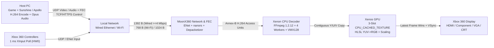

# MoonX360 Architecture

MoonX360 is a native Xbox 360 streaming client built with the **Xbox 360 SDK (XDK)** on top of **moonlight-common-c**, **FFmpeg 1.2.12**, **Mbed TLS 2.16.12**, and **Opus 1.5.2**.

---

## 1. End-to-End Streaming Pipeline

---

## 2. Core Subsystems

### Network, Control & Pairing (`src/http.c`, `src/gamestream.c`, `xdk/src/enet_xbox.c`)
- **HTTP / HTTPS Control:** Uses Mbed TLS `2.16.12` over Winsock for `/serverinfo`, `/pair`, `/applist`, `/launch`, and `/cancel`. Every request uses `Connection: close` with immediate `mbedtls_ssl_close_notify` and `closesocket()` to prevent wedging Apollo/Vibepollo/Sunshine port `47984`.
- **RTP & FEC:** `moonlight-common-c` + `nanors` reconstruct lost UDP shards. On wired Ethernet links (`XNetGetEthernetLinkStatus()`) with `packet_size == 1024` and `bitrate_kbps >= 4000`, `console_link_effective_packet_size()` upgrades payload size to `1392` bytes (`E8`), reducing per-frame packet count.
- **ENet Stack Buffer:** `enet_socket_send()` uses a `1536`-byte stack buffer instead of per-packet heap `malloc()`/`free()`.

### H.264 CPU Decoding (`xdk/patches/`, `xdk/ffmpeg_xbox/`)
- **FFmpeg 1.2.12 (`libavcodec 54.92.100`)**: Uses `FF_THREAD_SLICE` across **4 persistent Xenon worker threads** with the `legacy` slice dispatch path (`XDK_SLICE_DISPATCH=legacy`).
- **Active Patch Stack (13 patches):**
  - 10 `batch16` patches (`r47c-ordered-deblock`, `r47c-wavefront-deblock`, `r47c-row-progress`, `r47d-batch8`, `r47d-long-slices`, `r47d-edge16`, `r47d-edge-transpose`, `r47d-dispatch-profile`, `r47d-first-idr`, `r48-batch16`) supporting up to 16-slice frames with normative wavefront macroblock-row deblocking and Longest-Processing-Time-first (LPT) slice ordering.
  - 3 `v026-rc2` PowerPC/VMX128 patches (`v026-opt1-edge-nolhs`, `v026-opt4-chroma-lf-nolhs`, `v026-chroma-optA-vmx1d`) removing load-hit-store stalls in luma/chroma loop filtering and vectorizing 1D chroma motion compensation.
- **Normative Reference Integrity:** Full in-loop deblocking remains active by default (`fast_decode=0`) so reference frames never drift across slices.

### GPU Texture Transfer & Frame Pacing (`xdk/src/video_cached.cpp`, `xdk/src/gfx_xdk.cpp`, `src/frame_pacing.h`)
- **3-Slot `CPU_CACHED_TEXTURE` Pipeline:** Decoded Y, U, and V planes are copied into cached `D3DFMT_LIN_L8` textures using `__dcbt` prefetch, `__dcbz128` cache zeroing, and contiguous `XMemCpy` (`E5b`). Explicit D3D9 GPU fences prevent overwriting textures still in flight.
- **Xenos HLSL Presentation:** Single-pass D3D9 pixel shaders handle YUV→RGB color conversion (Rec.709 for HD, Rec.601 for SD/CRT) and scaling (`Auto`, `Point / Nearest`, `Bilinear`, `Sharp-Bilinear`). An optional **GPU Post-Deblock** shader is available (`Off` by default) and only activates when the host explicitly signals `disable_deblocking_filter_idc=1`.
- **Frame Pacing (`FRAME_PACING_LATEST_WINS`):** Enabled by default (`E9`), selecting the latest decoded frame prior to VBlank to minimize queue lag.

### Input, Desktop Mode & Audio (`xdk/src/input_xdk.cpp`, `src/desktop_input.h`, `xdk/src/audio_xdk.cpp`)
- **Controller Thread (`E7`):** Dedicated `1 ms` `XInputGetState` thread pinned to Xenon hardware thread `0` (`XDK_INPUT_HW_THREAD=0`) with staggered `100 ms` disconnected-port re-probing and optional `Start + LB` (`350 ms`) PC Guide button emulation.
- **Desktop Mode:** Radial stick deadzone (`desktop_stick_vector`), progressive low-deflection curve, `125 Hz` (`8 ms`) subpixel accumulation, and integrated 5-row Smart Virtual Keyboard (`src/ui/smart_keyboard.h`).
- **Audio:** Opus `1.5.2` decoding to XAudio2 (`Stereo` default, optional `5.1` request with automatic stereo fallback).
